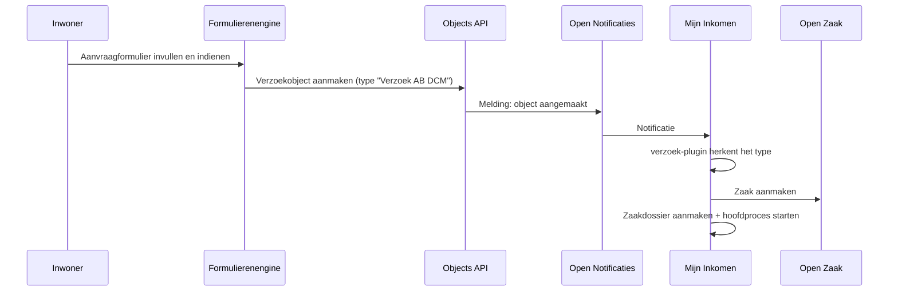

# Een zaak starten

## In productie: het formulier maakt een verzoekobject

Mijn Inkomen luistert niet rechtstreeks naar het klantportaal. Daar zit de Objects API tussen. De keten ziet er zo uit:



Stap voor stap:

1. **De inwoner dient het formulier in.** De formulierenengine schrijft het resultaat weg als **object** in de Objects API, van het objecttype *Verzoek ALO*.
2. **Open Notificaties meldt dat** er een object is aangemaakt.
3. **De `verzoek`-plugin** in Mijn Inkomen vangt die notificatie op. Aan de hand van het veld `type` in het object bepaalt hij om welke regeling het gaat.
4. **Het proces `create-zaakdossier` start.** Dat maakt de zaak aan in Open Zaak, legt de indiener vast als *Initiator*, en start het hoofdproces — `ab-afhandelen-aanvraag-dcm` voor Algemene bijstand.
5. **Het dossier wordt geïnitialiseerd**: ontvangstdatum, zaaknummer en de gemapte aanvraaggegevens komen in het zaakdossier te staan.


Het object is dus de **koppeling** tussen portaal en behandeling, niet alleen een doorgeefluik. Het blijft bestaan en het zaakdossier bewaart er een verwijzing naar. Zie [Integraties](../koppelingen/integraties.md#hoe-een-verzoek-een-zaak-wordt).


### Welk verzoektype hoort bij welke regeling

De `verzoek`-plugin is per verzoektype geconfigureerd. Het veld `type` in het object bepaalt alles wat daarna gebeurt:

| Veld in het object | Betekenis |
| --- | --- |
| `type` | Het verzoektype, bijvoorbeeld `Verzoek AB DCM`. Bepaalt zaaktype en hoofdproces. |
| `bsn` | De aanvrager; wordt als Initiator aan de zaak gekoppeld. |
| `public_reference` | Het referentienummer van het formulier. Komt terug in de zaaklijst. |
| `submission_id` | De inzending in de formulierenengine. |
| `data` | De ingevulde formuliergegevens, in de structuur van het aanvraagformulier. |

De gegevens onder `data` hebben niet dezelfde vorm als het zaakdossier. Ze komen eerst terecht onder `verzoekGegevensTeTransformeren`, waarna een *value mapping* ze omzet. Zie [Datamodel](../gegevens/datamodel.md#van-portaal-naar-dossier-value-mapping).

## In een testomgeving: zelf een verzoek aanmaken

Je hebt geen portaal nodig om een zaak te starten. Omdat de keten op de Objects API aanhaakt, volstaat één REST-aanroep: maak het verzoekobject aan, en de rest gebeurt vanzelf.

### Het request

```http
POST http://localhost:8010/api/v2/objects
Content-Type: application/json
Content-Crs: EPSG:4326
Accept-Crs: EPSG:4326
Authorization: Token <objects-api-token>

{
  "type": "http://host.docker.internal:8011/api/v2/objecttypes/<verzoek-alo-objecttype-uuid>",
  "record": {
    "typeVersion": 1,
    "startAt": "2026-11-09",
    "data": {
      "bsn": "<bsn-van-de-testpersoon>",
      "type": "Verzoek AB DCM",
      "language_code": "nl",
      "attachments": [],
      "submission_id": "test-001",
      "public_reference": "OF-TEST0001",
      "data": {
        "your-details": { "…": "formuliergegevens" }
      }
    }
  }
}
```

Een antwoord met **HTTP 201** betekent dat het object is aangemaakt. Kort daarna verschijnt de zaak in de zaaklijst.

### Waar de waarden vandaan komen

| Waarde | Waar je hem vindt |
| --- | --- |
| Objects API-URL en token | `AUTODEPLOYMENT_PLUGINCONFIG_OBJECTS-API_URL` en `…-AUTHENTICATION_TOKEN` in `application-local.yml` |
| Objecttype-UUID | `AUTODEPLOYMENT_OBJECTMANAGEMENT_VERZOEK_ALO_OBJECTTYPE_UUID` in dezelfde file |
| Voorbeeldpayloads | De `.http`-bestanden van **persona-lab**, die samenhangende testpersona's genereren |

### Eén hostnaam, overal dezelfde


**Dit is de hardnekkigste valkuil van de lokale opstelling.** De backend draait op de host, alle andere componenten in containers. `localhost` betekent aan weerszijden iets anders: voor een container is het de container zelf. Alleen **`host.docker.internal`** verwijst vanuit beide werelden naar hetzelfde.

Meerdere onderdelen vergelijken objecttype-URL's als **tekst**, niet als netwerkadres. Staat ergens `localhost` en elders `host.docker.internal`, dan is het dezelfde service maar niet dezelfde string — en dan faalt de vergelijking stil.


Het breekt op minstens twee plekken, met heel verschillende symptomen:

| Waar | Symptoom |
| --- | --- |
| **Objects API, bij het aanmaken** | `HTTP 403 — You do not have permission to perform this action`, ook met een geldig token. De API koppelt permissies aan service-URL plus objecttype-UUID en herkent het objecttype niet. |
| **Open Notificaties, bij het bezorgen** | Geen foutmelding, maar **er gebeurt niets**. Het abonnement filtert op de objecttype-URL; wijkt die af, dan matcht de notificatie niet en wordt er nooit bezorgd. De zaak blijft uit. |

Dat tweede geval is het vervelendst: alles meldt succes. Het object krijgt een 201, Open Notificaties neemt de melding aan met een 201, en toch komt er geen zaak.

**De regel: kies `host.docker.internal` en gebruik die overal** — in de objecttype-URL van je request, in de plugin-URL's voor de Objects en Objecttypes API, en in de service-registratie binnen de Objects API zelf. Wijk nergens af, ook niet "even snel".

Controleren of het klopt:

```bash
# Waar wijst de Objects API naar voor objecttypen?
docker exec <objecten-api-database> psql -U objects -d objects \
  -t -A -c "select api_root from zgw_consumers_service;"

# Waar filtert het abonnement op?
docker exec <open-notificaties-database> psql -U notifications -d notifications \
  -t -A -c "select key, value from datamodel_filter;"
```

Die twee moeten dezelfde host noemen als het `type`-veld in je request.

### Handmatig vanuit de applicatie

Voor een enkel dossier kan het ook zonder REST. In de zaaklijst staat rechtsboven de knop **Creëer Nieuw Dossier**. Dat maakt een zaak aan zonder verzoekobject; het initialisatieproces slaat het mappen van portaalgegevens dan over.

Deze route gebruik je ook in productie voor een aanvraag die op een andere manier is binnengekomen, bijvoorbeeld op papier.

## Als de zaak uitblijft

Verschijnt er na het aanmaken van het object geen zaak, loop dan deze keten langs:

| Controle | Wat je nagaat |
| --- | --- |
| Is het object aangemaakt? | Het POST-antwoord moet 201 zijn. |
| Klopt het `type`-veld? | Moet exact overeenkomen met een geconfigureerd verzoektype, bijvoorbeeld `Verzoek AB DCM`. |
| Draait Open Notificaties? | Zonder notificatie hoort Mijn Inkomen niets. |
| Bestaat het abonnement? | Open Notificaties moet een abonnement hebben op het objecttype-kanaal. |
| Draait de backend? | Een notificatie die niemand aanneemt, leidt niet tot een zaak. |
| Komen de hostnamen overeen? | Zie [Eén hostnaam, overal dezelfde](#een-hostnaam-overal-dezelfde). Dit faalt stil. |


**Een notificatie wordt verstuurd op het moment van aanmaken.** Ligt de backend er op dat moment uit, dan is de melding mogelijk verloren en komt er geen zaak — ook niet nadat de backend weer draait. Maak in dat geval het object opnieuw aan, met een nieuw `submission_id` en `public_reference`.

