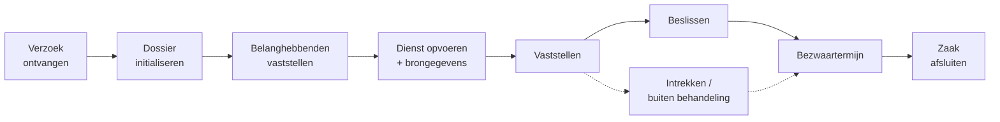
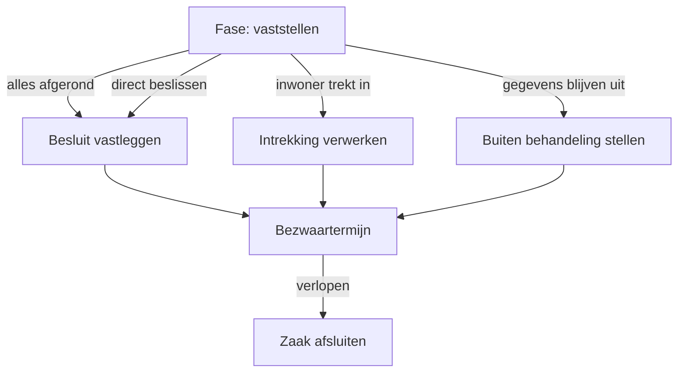

# Het aanvraagproces

## De grote lijn

Het bijbehorende hoofdproces heet `ab-afhandelen-aanvraag-dcm` (Algemene bijstand) of `ioaw-afhandelen-aanvraag-dcm` (IOAW). Dat proces doet zelf opvallend weinig: het initialiseert het dossier, zet de zaakstatus, start het regieproces en bewaakt de afhandeltermijn. Al het inhoudelijke werk gebeurt in de business services die de regie aanstuurt.

## Stap 1 — Binnenkomst

De inwoner dient de aanvraag in via het klantportaal. Die aanvraag belandt als object in de Objects API; Open Notificaties meldt dat aan Mijn Inkomen. De `verzoek`-plugin pikt de notificatie op en start het proces `create-zaakdossier`, dat een zaak aanmaakt en het hoofdproces start.

De indiener wordt vastgelegd als **Initiator** op de zaak.

## Stap 2 — Dossier initialiseren

Het subproces `ab-initialiseren-dossier` maakt het dossier klaar voor behandeling:

| Actie | Toelichting |
| --- | --- |
| Ontvangstdatum vastleggen | Startpunt voor de afhandeltermijn. |
| Zaakidentificatie opslaan | Het zaaknummer uit Open Zaak komt in het dossier. |
| Aanvraaggegevens mappen | De portaalgegevens worden via een *value mapping* omgezet naar de dossierstructuur. |
| Referentie opslaan | Verwijzing naar het oorspronkelijke verzoekobject. |
| Roltype vastleggen | De aanvrager wordt als betrokkene aan de zaak gekoppeld. |
| Label zetten | Bij een verkorte aanvraagprocedure krijgt de zaak het label *Verkorte aanvraagprocedure*. |


Een zaak kan ook handmatig worden aangemaakt in plaats van via het portaal. Het proces herkent dat en slaat het mappen van portaalgegevens dan over.


De zaak krijgt interne status **Aanvraag ontvangen**.

## Stap 3 — De regie neemt het over

Vanaf hier draait `uitvoeren-business-services`. Dat proces wacht op gebeurtenissen, legt elke gebeurtenis voor aan de beslistabel `besturen-business-services`, en voert uit wat daar uitkomt.

De eerste gebeurtenis zet de boel in gang: `aanvraag-in-behandeling-genomen`. De zaak gaat naar interne status **In behandeling genomen** en naar fase `vaststellen-belanghebbenden`.

## De fasen

| Fase | Wat er gebeurt | Hoe de fase eindigt |
| --- | --- | --- |
| `vaststellen-belanghebbenden` | Identiteit van aanvrager (en partner) vaststellen. | Beide personen vastgesteld. |
| `opvoeren-dienst` | Dienst opvoeren in Socrates en brongegevens ophalen. | Dienst opgevoerd én brongegevens binnen. |
| `vaststellen` | Alle inhoudelijke vaststellingen, parallel. | Alle vaststellingen afgerond. |
| `beslissen` | Besluit vastleggen. | Besluit vastgelegd. |
| `beslist` | Bezwaartermijn loopt. | Termijn verlopen. |
| `intrekken` | Inwoner trekt de aanvraag in. | Intrekking verwerkt. |
| `buiten-behandeling-stellen` | Aanvraag wordt niet inhoudelijk beoordeeld. | Beslissing verwerkt. |
| `afsluiten` | Zaak administratief afronden. | Zaak gesloten. |

### Fase 1 — Belanghebbenden vaststellen

De regie start `bsb-211-vaststelling-persoon-aanvrager`. Is er een partner in de aanvraag, dan start na afronding daarvan ook `bsb-211-vaststelling-persoon-partner`.

De fase is pas klaar als alle benodigde personen vastgesteld zijn — bij een aanvraag zonder partner dus na één vaststelling, met partner na twee. Dat wordt bewaakt door een eigen beslissing in de DMN (*Fase vaststellen belanghebbenden afgerond*).

### Fase 2 — Dienst opvoeren en brongegevens ophalen

Nu de personen bekend zijn, kan de dienst worden opgevoerd in Socrates. Zodra dat gelukt is (`dienst-in-socrates-opgevoerd`), start het ophalen van de brongegevens voor de aanvrager, en daarna — indien van toepassing — voor de partner.

Zie [Brongegevens](../gegevens/bronnen.md) voor wat er precies wordt opgehaald.

### Fase 3 — Vaststellen

Dit is het zwaartepunt van de behandeling. Zodra de vorige fase klaar is, zet de regie **in één keer** een groot aantal bouwblokken aan, die daarna parallel lopen.



* `bsb-overwegen-inzetten-handhaving`
* `bsb-overwegen-uitzetten-informatieverzoek`
* `bsb-213-vaststelling-verblijfstitel-aanvrager`
* `bsb-218-vaststelling-uitsluitingsgronden-aanvrager`
* `bsb-442-vaststelling-identiteit-aanvrager`
* `bsb-224-vaststelling-inkomen-aanvrager`
* `bsb-214-vaststelling-vermogen`
* `bsb-444-vaststelling-voorliggende-voorzieningen`
* `bsb-221-vaststelling-ingangsdatum`



* `bsb-overwegen-inzetten-handhaving`
* `bsb-overwegen-uitzetten-informatieverzoek`
* `bsb-213-vaststelling-verblijfstitel-aanvrager`
* `bsb-218-vaststelling-uitsluitingsgronden-aanvrager`
* `bsb-442-vaststelling-identiteit-aanvrager`
* `bsb-444-vaststelling-voorliggende-voorzieningen`
* `bsb-221-vaststelling-ingangsdatum`
* `bsb-212-vaststelling-bijstandsvorm`




**Het verschil tussen beide regelingen zit hier.** Bij IOAW ontbreken de vaststellingen van vermogen (BS 214) en inkomen (BS 224): voor IOAW is vermogen niet relevant. In ruil daarvoor start de bijstandsvorm (BS 212) direct mee, terwijl die bij Algemene bijstand pas start zodra het vermogen is vastgesteld.


Tijdens deze fase komen er vanzelf meer bouwblokken bij, telkens getriggerd door een gebeurtenis:

| Gebeurtenis | Start dan |
| --- | --- |
| `identiteit-aanvrager-vastgesteld` (met partner) | Vaststelling identiteit partner |
| `inkomen-aanvrager-vastgesteld` (met partner) | Vaststelling inkomen partner |
| `inkomen-partner-vastgesteld` | Vaststelling gezamenlijk inkomen (BS 224b) |
| `vermogen-vastgesteld` | Vaststelling bijstandsvorm (BS 212) |
| `op-te-vragen-items-bepaald` | Uitzetten en opvolgen informatieverzoek |
| `handhaving-ingezet` | Vastleggen resultaat inzet handhaving |

### Wanneer is "vaststellen" klaar?

Een aparte beslissing in de DMN (*Fase 'vaststellen' afgerond*) controleert continu of alle relevante vaststellingen de status `afgerond` hebben en geen enkel bouwblok nog `gestart` is. Zodra dat zo is, start de regie automatisch `bsb-vastleggen-besluit` en gaat de zaak naar fase `beslissen`.

Omdat de controle per regeling verschilt, zijn er twee regels: bij IOAW tellen vermogen, norm en inkomen niet mee.

## Terugspringen vanuit het besluit

Een van de krachtigste eigenschappen van het ontwerp: blijkt tijdens het beslissen dat een vaststelling niet klopt, dan hoeft het dossier niet opnieuw. De behandelaar start één vaststelling opnieuw, waarna de regie:

1. het betreffende bouwblok opnieuw start;
2. `bsb-vastleggen-besluit` annuleert — er valt immers nog niets te beslissen;
3. de fase terugzet van `beslissen` naar `vaststellen`.

Zodra de hernieuwde vaststelling klaar is, constateert de controle opnieuw dat alles afgerond is, en komt het besluit vanzelf weer terug.

Dit werkt voor onder meer vermogen, norm, inkomen, ingangsdatum, verblijfstitel, verblijfadres, relaties en leef- en woonsituatie.


Sommige vaststellingen hangen samen. Start de behandelaar de verblijfstitel opnieuw, dan annuleert de regie óók verblijfadres, leef- en woonsituatie en relaties: die konden immers op de oude verblijfstitel gebaseerd zijn.


## De hele behandeling opnieuw

Loopt het dossier echt vast, dan kan de behandelaar de volledige behandeling opnieuw starten — dat kan vanuit elke fase vanaf `vaststellen`, dus ook nog nadat er beslist is. De regie annuleert dan **alle actieve bouwblokken** en zet de complete set vaststellingen opnieuw aan.

Het bijbehorende startproces is `ab-start-behandeling-gehele-aanvraag-opnieuw-starten`.

## Afsluitende routes

| Route | Toelichting |
| --- | --- |
| **Regulier besluit** | Alle vaststellingen zijn rond; het besluit wordt vastgelegd. |
| **Direct beslissen** | De behandelaar beslist zonder alle vaststellingen af te wachten. Alle actieve bouwblokken worden geannuleerd. |
| **Intrekking** | De inwoner trekt de aanvraag in. Alle actieve bouwblokken worden geannuleerd. |
| **Buiten behandeling** | Gevraagde gegevens blijven uit. Alle actieve bouwblokken worden geannuleerd. |

Alle vier de routes komen uit bij de bezwaartermijn. Pas als die verloopt (`bezwaartermijn-verlopen`), start `bsb-afsluiten-zaak` en gaat de zaak naar status **Afgehandeld**.

## Termijnbewaking

Het hoofdproces bewaakt de wettelijke afhandeltermijn met twee signalen:

* **Afhandeltermijn bijna verlopen** — de zaak krijgt het label *Te laat*;
* **Afhandeltermijn verlopen** — de zaak krijgt het label *Achterstallig*.

Daarnaast tonen de dashboards zaken die langer dan 4 of 8 weken openstaan. Zie [Werken in de applicatie](werken-in-de-applicatie.md).

## Acties die de behandelaar zelf kan starten

Naast het reguliere verloop kan de behandelaar losse processen starten. Elk daarvan stuurt een gebeurtenis naar de regie:

| Actie | Proces (AB) |
| --- | --- |
| Aanvraag direct beslissen | `ab-start-aanvraag-direct-beslissen` |
| Aanvraag intrekken | `ab-start-intrekken-aanvraag` |
| Buiten behandeling stellen | `ab-start-buiten-behandeling-stellen` |
| Behandeling opnieuw starten | `ab-start-behandeling-gehele-aanvraag-opnieuw-starten` |
| Taak opnieuw starten | `ab-start-taak-opnieuw-starten` |
| Contactgegevens wijzigen | `ab-start-wijzigen-contactgegevens` |
| Brongegevens verversen | `ab-start-verversen-brongegevens` |
| Informatieverzoek annuleren | `ab-start-annuleren-informatieverzoek-dcm` |
| Deadline informatieverzoek verlengen | `ab-start-verlengen-deadline-informatieverzoek-dcm` |
| Reactie op informatieverzoek vastleggen | `ab-start-reactie-informatieverzoek-dcm` |

Voor IOAW bestaan dezelfde processen met het voorvoegsel `ioaw-`.
