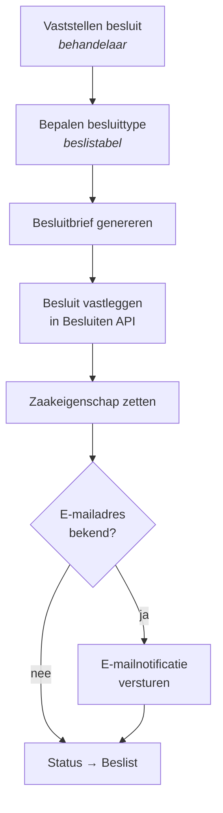
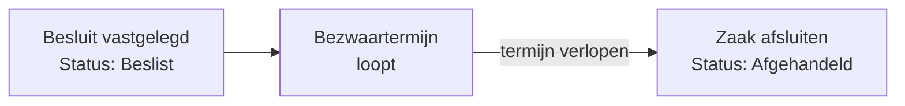

# Besluit en afsluiting

## Vier uitkomsten

Elke aanvraag eindigt in een van vier besluiten. Die worden vastgelegd in het zaakdossier onder `besluiten` en vertaald naar de formele registratie in Open Zaak.

| Besluit | Besluittype | Resultaattype |
| --- | --- | --- |
| `TOEGEKEND` | Toekenningsbesluit | Verstrekt |
| `AFGEWEZEN` | Afwijzingsbesluit | Geweigerd |
| `BUITEN_BEHANDELING_GESTELD` | Buiten behandeling gesteld | Buiten behandeling gesteld |
| `INGETROKKEN` | Intrekking | Afgebroken |

De vertaling gebeurt door twee kleine beslistabellen: `alo-bepaal-besluittype.dmn` en `alo-bepalen-resultaattype.dmn`.

## Het besluit vastleggen

De service *Vastleggen besluit* start automatisch zodra de regie constateert dat alle vaststellingen afgerond zijn. De behandelaar kan hem ook eerder forceren met *Aanvraag direct beslissen*.

Wat er gebeurt:

1. **Vaststellen besluit.** De behandelaar kiest de uitkomst. Bij een afwijzing hoort een reden; het dossier kent daarvoor onder meer `redenAfwijzing` en `vervalreden`. Ook wordt vastgelegd wie de beslisser is en of er versneld is beslist.
2. **Besluittype bepalen.** De beslistabel vertaalt de keuze naar het juiste besluittype.
3. **Besluitbrief genereren.** Op basis van het sjabloon `besluit.ftlh` wordt een document gemaakt en opgeslagen in de Documenten API.
4. **Besluit vastleggen.** Het besluit wordt met de bijbehorende brief geregistreerd in de Besluiten API en aan de zaak gekoppeld.
5. **Notificatie.** Is er een e-mailadres bekend, dan krijgt de inwoner bericht dat er beslist is.
6. **Status bijwerken.** De zaak gaat naar interne status **Beslist** en de gebeurtenis `vastleggen-besluit-afgerond` gaat naar de regie.


**Het besluit kan nog terug naar de tekentafel.** Blijkt tijdens het vaststellen van het besluit dat een onderliggende vaststelling niet klopt, dan start de behandelaar die vaststelling opnieuw. De regie annuleert het lopende besluit automatisch en zet de zaak terug naar fase `vaststellen`. Zie [Het aanvraagproces](aanvraagproces.md#terugspringen-vanuit-het-besluit).


## Intrekking

Trekt de inwoner de aanvraag zelf in, dan start de behandelaar `ab-start-intrekken-aanvraag`. De regie:

1. annuleert **alle actieve bouwblokken** — er valt niets meer vast te stellen;
2. start *Verwerken intrekking*;
3. zet de fase op `intrekken`.

De behandelaar legt de intrekking vast; het besluit `INGETROKKEN` volgt met resultaattype *Afgebroken*. Daarna gaat de zaak de bezwaartermijn in.

## Buiten behandeling stellen

Levert de inwoner gevraagde gegevens niet aan, dan kan de aanvraag buiten behandeling worden gesteld: er volgt geen inhoudelijke beoordeling.

Het verloop is gelijk aan dat van de intrekking — alle actieve bouwblokken worden geannuleerd, fase wordt `buiten-behandeling-stellen` — met als verschil dat het besluit `BUITEN_BEHANDELING_GESTELD` is.


Buiten behandeling stellen kan niet zomaar. Er moet een informatieverzoek zijn uitgegaan, de inwoner moet een redelijke hersteltermijn hebben gehad, en die termijn moet ongebruikt verstreken zijn. Het proces borgt de volgorde, maar de inhoudelijke toets blijft bij de behandelaar.


## De bezwaartermijn

Alle vier de routes komen uit bij dezelfde stap: `bsb-lopende-bezwaartermijn`. De zaak blijft open zolang de inwoner bezwaar kan maken.

De fase is in deze periode `beslist`. Verloopt de termijn, dan volgt de gebeurtenis `bezwaartermijn-verlopen` en start `bsb-afsluiten-zaak`.

## Zaak afsluiten

Het afsluiten rondt de zaak administratief af:

* het resultaat wordt in Open Zaak vastgelegd volgens het bepaalde resultaattype;
* de zaak krijgt een einddatum en wordt gesloten;
* de interne status gaat naar **Afgehandeld**;
* het hoofdproces bereikt zijn eindgebeurtenis *zaak afgesloten*.

Het zaakdossier blijft bewaard en raadpleegbaar; het volledige verloop is terug te zien op de tabbladen **Voortgang** en **Audit**.

## Terug naar behandeling, ook na een besluit

Ook een beslist dossier is niet definitief dicht. Zolang de zaak nog niet is afgesloten, kan de behandelaar de volledige behandeling opnieuw starten — de regie staat dat expliciet toe vanuit de fasen `vaststellen`, `beslissen`, `beslist`, `intrekken` en `buiten-behandeling-stellen`.

Alle actieve bouwblokken worden dan geannuleerd en de complete set vaststellingen start opnieuw, waarna de zaak terugkeert naar fase `vaststellen`.

## Brieven en sjablonen

| Brief | Sjabloon | Wanneer |
| --- | --- | --- |
| Ontvangstbevestiging | `ontvangsbevestiging.ftlh` | Bij binnenkomst van de aanvraag. |
| Informatieverzoek | `informatieverzoek.ftlh` | Bij het uitzetten van een informatieverzoek. |
| Besluit | `besluit.ftlh` | Bij het vastleggen van het besluit. |

Per regeling bestaat er een eigen configuratiebestand dat het sjabloon aan het zaaktype koppelt, zodat de aanhef en toelichting per regeling kunnen verschillen. De sjablonen horen bij het bouwblok dat de brief genereert.

Daarnaast zijn er **teksttemplates** die in de zaaklijst worden gebruikt om afgeleide waarden te tonen, zoals de volledige naam van de aanvrager, de postcode en het genomen besluit.
