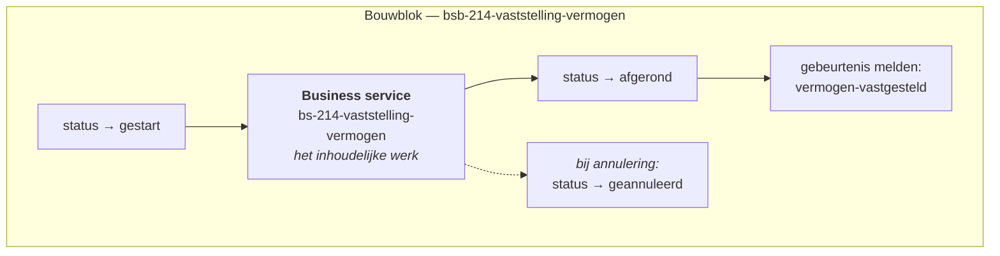
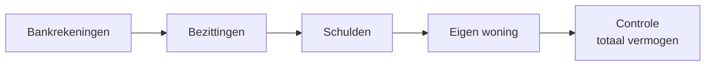
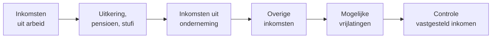
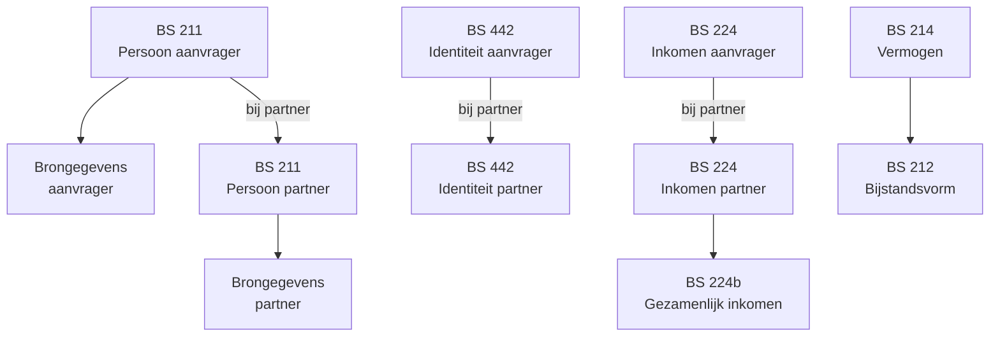

# Business services

Een **business service** is één afgebakend stuk werk binnen de behandeling: het vaststellen van het vermogen, het bepalen van de norm, het uitzetten van een informatieverzoek. De nummering (BS 211, BS 214, …) volgt de landelijke referentie voor inkomensvoorzieningen, zodat de implementatie herkenbaar blijft naast het beleidsontwerp.

## Hoe een business service werkt

Elke business service bestaat uit twee lagen:

Het **bouwblok** regelt het huishoudelijke werk — status bijhouden, netjes afbreken, terugmelden aan de regie. De **business service** erbinnen doet het inhoudelijke werk. Die scheiding zorgt ervoor dat de regie elk bouwblok op dezelfde manier kan aansturen, zonder iets te weten van wat erin gebeurt.

### De statuscyclus

| Status | Betekenis |
| --- | --- |
| `gestart` | De service loopt; er staat werk open. |
| `afgerond` | Het werk is klaar en het resultaat staat in het dossier. |
| `geannuleerd` | De regie heeft de service afgebroken omdat hij niet meer nodig is. |

Deze statussen zijn wat de controle *"is de fase vaststellen afgerond?"* uitleest. Zolang één service nog op `gestart` staat, is de fase niet klaar.

## Catalogus

### Vaststellingen

Deze services stellen de feiten vast waarop het recht wordt beoordeeld. Klik door voor het procesverloop, de invoer en de uitvoer per service.

| Nr. | Business service | Wat er wordt vastgesteld |
| --- | --- | --- |
| **211** | [Vaststelling persoon](business-services/bs-211-vaststelling-persoon.md) | Wie is de aanvrager, en wie de partner. Basis voor alle verdere stappen. |
| **212** | [Vaststelling bijstandsvorm](business-services/bs-212-vaststelling-bijstandsvorm.md) | In welke vorm de bijstand wordt verleend. |
| **213** | [Vaststelling verblijfstitel](business-services/bs-213-vaststelling-verblijfstitel.md) | De verblijfsstatus van aanvrager en partner. |
| **214** | [Vaststelling vermogen](business-services/bs-214-vaststelling-vermogen.md) | Bankrekeningen, bezittingen, schulden en eigen woning. *Alleen Algemene bijstand.* |
| **216** | [Vaststelling relaties](business-services/bs-216-vaststelling-relaties.md) | Relaties van aanvrager en partner die van invloed zijn op het recht. |
| **217** | [Vaststelling verblijfadres](business-services/bs-217-vaststelling-verblijfadres.md) | Waar aanvrager en partner feitelijk verblijven. |
| **218** | [Vaststelling uitsluitingsgronden](business-services/bs-218-vaststelling-uitsluitingsgronden.md) | Omstandigheden die recht uitsluiten, zoals detentie of verblijf in het buitenland. |
| **219** | [Vaststelling norm](business-services/bs-219-vaststelling-norm.md) | Het maandbedrag waar de aanvrager recht op heeft. |
| **219** | [Bepalen individueel kostendelersnormbedrag](business-services/bs-219-bepalen-individueel-kostendelersnormbedrag.md) | Deelberekening binnen de normvaststelling. |
| **221** | [Vaststelling ingangsdatum](business-services/bs-221-vaststelling-ingangsdatum-uitkering.md) | Vanaf wanneer de uitkering ingaat. |
| **223** | [Vaststelling leef- en woonsituatie](business-services/bs-223-vastsstellen-leef-en-woonsituatie.md) | Alleenstaand, samenwonend, medebewoners, woonvorm. |
| **224** | [Vaststelling inkomen](business-services/bs-224-vaststelling-inkomen.md) | Inkomsten uit arbeid, uitkering, pensioen, studiefinanciering en onderneming. *Alleen Algemene bijstand.* |
| **224b** | [Vaststelling gezamenlijk inkomen](business-services/bs-224b-vaststellen-gezamenlijk-inkomen.md) | Het inkomen van aanvrager en partner samen. |
| **444** | [Vaststelling voorliggende voorzieningen](business-services/bs-444-vaststelling-voorliggende-voorzieningen.md) | Bestaat er een andere regeling die vóór de bijstand gaat? |


**BS 442 — vaststelling identiteit — is leeg.** De regie start het bouwblok nog wel, voor aanvrager en partner, maar er zit geen business service onder: het procesmodel gaat rechtstreeks van start naar einde. Er gebeurt dus niets.

Je vindt daarom geen eigen pagina voor BS 442 in deze lijst. Houd er rekening mee dat ontwerpdocumenten die de identiteitsvaststelling beschrijven, niet overeenkomen met wat de applicatie doet.


### Procesondersteunend

Deze services voeren het proces uit in plaats van feiten vast te stellen.

| Business service | Functie |
| --- | --- |
| [Opvoeren dienst in Socrates](business-services/bs-opvoeren-dienst-in-socrates.md) | Meldt de aanvraag aan bij de uitkeringsadministratie. |
| [Ophalen brongegevens](business-services/bs-ophalen-brongegevens.md) | Haalt gegevens op bij de landelijke bronnen. |
| [Ophalen BRP t.b.v. vaststellen persoon](business-services/bs-211-ophalen-brp-tbv-vaststellen-persoon.md) | Haalt de BRP-gegevens op die BS 211 nodig heeft. |
| [Ophalen bewoning adres](business-services/bs-ophalen-bewoning-adres.md) | Haalt op wie er op het adres staan ingeschreven. |
| [Ophalen verzendadres](business-services/bs-ophalen-verzendadres.md) | Bepaalt waar post naartoe moet. |
| [Overwegen uitzetten informatieverzoek](business-services/bs-overwegen-uitzetten-informatieverzoek.md) | Beoordeelt of er aanvullende stukken nodig zijn. |
| [Uitzetten en opvolgen informatieverzoek](business-services/bs-uitzetten-en-opvolgen-informatieverzoek.md) | Zet het verzoek uit, bewaakt de deadline, beoordeelt de reactie. |
| [Overwegen inzetten handhaving](business-services/bs-overwegen-inzetten-handhaving.md) | Beoordeelt of er aanleiding is voor een poortonderzoek. |
| [Vastleggen resultaat inzet handhaving](business-services/bs-vastleggen-resultaat-inzet-handhaving.md) | Verwerkt de uitkomst van dat onderzoek. |
| [Overwegen voorschot](business-services/bs-overwegen-voorschot.md) | Beoordeelt of een voorschot nodig is. |
| [Opbouwen uitgebreide motivering](business-services/bs-opbouwen-uitgebreide-motivering.md) | Bouwt de motivering op die onder het besluit ligt. |
| [Vastleggen besluit](business-services/bs-vastleggen-besluit.md) | Legt de beslissing op de aanvraag vast. |
| [Verwerken intrekking](business-services/bs-verwerken-intrekking.md) | Verwerkt een intrekking door de inwoner. |
| [Verwerken buiten behandeling stelling](business-services/bs-verwerken-buiten-behandeling-stelling.md) | Verwerkt een buiten-behandelingstelling. |
| [Vastleggen wijziging contactgegevens](business-services/bs-vastleggen-wijziging-contactgegevens-aanvrager.md) | Verwerkt gewijzigde contactgegevens van de aanvrager. |
| [Behandeling aanvraag opnieuw starten](business-services/bs-behandeling-aanvraag-opnieuw-starten.md) | Zet de volledige behandeling terug naar de vaststellingsfase. |
| [Genereren rapportage](business-services/bs-genereren-rapportage.md) | Stelt een rapportage over het dossier samen. |
| [Afsluiten zaak](business-services/bs-afsluiten-zaak.md) | Rondt de zaak administratief af. |


De pagina's achter deze links zijn gegenereerd uit de backend-configuratie met `scripts/generate-business-services.py`. In de navigatie staan ze ingeklapt onder deze pagina; het zijn naslagpagina's, geen leesstof.


## Een paar services uitgelicht

### BS 214 — Vaststelling vermogen

Het vermogen wordt vastgesteld via een formulierstroom in vijf stappen:

De eerste vier stappen worden zoveel mogelijk voorgevuld met de brongegevens uit het Kadaster, de RDW en de belastingdienstgegevens via Suwinet. De laatste stap toont het opgetelde vermogen zodat de behandelaar het geheel kan bevestigen.

Een aparte beslistabel bepaalt vervolgens of het vastgestelde vermogen boven de vrijlatingsgrens uitkomt.


Deze service draait alleen bij Algemene bijstand. Voor IOAW is vermogen niet relevant.


### BS 224 — Vaststelling inkomen

Ook het inkomen wordt via een formulierstroom vastgesteld:

De stappen worden voorgevuld met gegevens van UWV (loondienst), SVB (uitkeringen) en DUO (studiefinanciering). De stap *mogelijke vrijlatingen* laat de behandelaar bepalen welke inkomsten buiten beschouwing blijven.

Bij een aanvraag met partner draait de service twee keer — voor aanvrager en partner — waarna BS 224b het gezamenlijk inkomen bepaalt.

### BS 219 — Vaststelling norm

De norm wordt in twee stappen bepaald:

1. **Het aantal rechthebbenden vaststellen.** Hoeveel volwassenen delen het huishouden? Dit bepaalt of de kostendelersnorm van toepassing is.
2. **Het basisnormbedrag opzoeken.** Een beslistabel koppelt de leefsituatie aan het geldende bedrag.

De beslistabel `bs-219-bepalen-basisnormbedrag` bevat de bijstandsnormen per peildatum, voor twintig combinaties van leeftijd, partnerschap en kinderen:

| Situatie | Code | 2026-01-01 |
| --- | --- | --- |
| Alleenstaand, 21 tot AOW | `M` | € 1.401,50 |
| Samenwonend, beiden 21 tot AOW | `MM` | € 2.002,13 |
| Alleenstaand, AOW-leeftijd | — | € 1.564,69 |
| Samenwonend, beiden AOW | — | € 2.144,16 |
| Alleenstaande jongere (18–20) | `J` | € 345,99 |
| Samenwonende jongeren (18–20) | `JJ` | € 691,98 |
| Aanvrager in inrichting | `I` | € 443,76 |
| Beiden in inrichting | `II` | € 690,27 |


**Deze bedragen worden halfjaarlijks geïndexeerd.** De tabel bevat regels per periode (1 juli 2024, 1 januari 2025, 1 juli 2025, 1 januari 2026). Bij elke indexering moet er een regel bij in de beslistabel `bs-219-bepalen-basisnormbedrag`, in het bouwblok `bs-219-vaststelling-norm`. Voor peildata vóór 1 juli 2024 geeft de tabel nul terug.


### BS 216 — Vaststelling relaties

Deze service werkt met een voorwaardelijke formulierstroom. De behandelaar geeft eerst aan of er relaties vast te stellen zijn. Zijn die er niet, dan is de service meteen klaar. Zijn ze er wel, dan volgt een samenvattingsscherm ter bevestiging.

## Afhankelijkheden tussen services

De meeste vaststellingen lopen onafhankelijk van elkaar, maar een paar hebben een vaste volgorde:

Daarnaast bestaat er een **annuleringssamenhang**: start de behandelaar BS 213 (verblijfstitel) opnieuw, dan annuleert de regie ook BS 217 (verblijfadres), BS 223 (leef- en woonsituatie) en BS 216 (relaties), omdat die op de oude verblijfstitel gebaseerd kunnen zijn.

## Waar staat wat

| Onderdeel | Waar |
| --- | --- |
| Alles van één business service | `config/building-block/<naam-van-het-blok>/` |
| Gedeelde formulieren en links | `config/global/` |
| Gedeelde schema's | `config/document/` |

Sinds v13 staat alles wat bij één business service hoort — procesmodel, bouwblok, formulieren, beslistabellen en schema — bij elkaar in één map.
