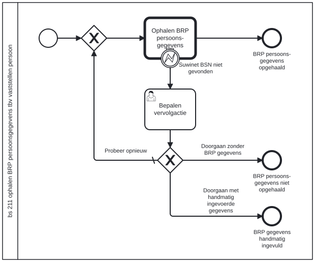

# BS 211 ophalen BRP persoonsgegevens tbv vaststellen persoon

Bouwblok `bs-211-ophalen-brp-tbv-vaststellen-persoon`.

## Invoer en uitvoer

Dit bouwblok benoemt geen invoer- en uitvoervariabelen in het procesmodel.

## Het procesmodel

Gegenereerd uit het BPMN-model. Open de afbeelding apart om in te zoomen.

## Het proces

| Soort | Stap |
| --- | --- |
| Aanroep | Ophalen BRP persoons-gegevens → `generic-suwinet-ophalen-brp-brongegevens` |
| Gebruikerstaak | Bepalen vervolgactie |
| Einde | BRP persoons-gegevens niet opgehaald |
| Einde | BRP persoons-gegevens opgehaald |
| Onderbreking | Suwinet BSN niet gevonden |
| Einde | BRP gegevens handmatig ingevuld |

## Onderdelen

**Formulieren**

* `bs-211-vaststelling-persoon.bepalen-vervolgactie`

Dit bouwblok heeft een eigen documentdefinitie.

---

Terug naar [Business services](../business-services.md).
