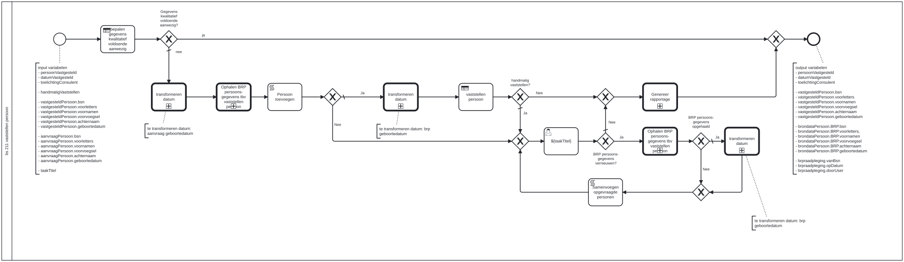

# BS 211 Vaststelling persoon

Bouwblok `bs-211-vaststelling-persoon`.

## Invoer en uitvoer

**Invoer**

* `persoonVastgesteld`
* `datumVastgesteld`
* `toelichtingConsulent`
* `handmatigVaststellen`
* `vastgesteldPersoon.bsn`
* `vastgesteldPersoon.voorletters`
* `vastgesteldPersoon.voornamen`
* `vastgesteldPersoon.voorvoegsel`
* `vastgesteldPersoon.achternaam`
* `vastgesteldPersoon.geboortedatum`
* `aanvraagPersoon.bsn`
* `aanvraagPersoon.voorletters`
* `aanvraagPersoon.voornamen`
* `aanvraagPersoon.voorvoegsel`
* `aanvraagPersoon.achternaam`
* `aanvraagPersoon.geboortedatum`
* `taakTitel`

**Uitvoer**

* `persoonVastgesteld`
* `datumVastgesteld`
* `toelichtingConsulent`
* `vastgesteldPersoon.bsn`
* `vastgesteldPersoon.voorletters`
* `vastgesteldPersoon.voornamen`
* `vastgesteldPersoon.voorvoegsel`
* `vastgesteldPersoon.achternaam`
* `vastgesteldPersoon.geboortedatum`
* `brondataPersoon.BRP.bsn`
* `brondataPersoon.BRP.voorletters,`
* `brondataPersoon.BRP.voornamen`
* `brondataPersoon.BRP.voorvoegsel`
* `brondataPersoon.BRP.achternaam`
* `brondataPersoon.BRP.geboortedatum`
* `brpraadpleging.vanBsn`
* `brpraadpleging.opDatum`
* `brpraadpleging.doorUser`

## Wie roept dit aan

| | |
| --- | --- |
| **Direct aangeroepen door** | `basisafhandelproces-bsb-211-vaststelling-persoon-aanvrager`, `basisafhandelproces-bsb-211-vaststelling-persoon-partner`, `bsb-211-vaststelling-persoon-aanvrager`, `bsb-211-vaststelling-persoon-partner` |
| **Binnen zaakproces** | Algemene bijstand aanvraag, Basisafhandelproces, IOAW aanvraag |

De volledige keten, met de technische procesnamen:

* `bs-211-vaststelling-persoon` ← `basisafhandelproces-bsb-211-vaststelling-persoon-aanvrager` ← `basisafhandelproces-uitvoeren-business-services` ← `basisafhandelproces-behandelen-zaak` ← `basisafhandelproces-afhandelen-aanvraag`
* `bs-211-vaststelling-persoon` ← `basisafhandelproces-bsb-211-vaststelling-persoon-partner` ← `basisafhandelproces-uitvoeren-business-services` ← `basisafhandelproces-behandelen-zaak` ← `basisafhandelproces-afhandelen-aanvraag`
* `bs-211-vaststelling-persoon` ← `bsb-211-vaststelling-persoon-aanvrager` ← `uitvoeren-business-services` ← `ab-afhandelen-aanvraag-dcm`
* `bs-211-vaststelling-persoon` ← `bsb-211-vaststelling-persoon-aanvrager` ← `uitvoeren-business-services` ← `ioaw-afhandelen-aanvraag-dcm`
* `bs-211-vaststelling-persoon` ← `bsb-211-vaststelling-persoon-partner` ← `uitvoeren-business-services` ← `ab-afhandelen-aanvraag-dcm`
* `bs-211-vaststelling-persoon` ← `bsb-211-vaststelling-persoon-partner` ← `uitvoeren-business-services` ← `ioaw-afhandelen-aanvraag-dcm`

## Het procesmodel

Gegenereerd uit het BPMN-model. Open de afbeelding apart om in te zoomen.

## Het proces

| Soort | Stap |
| --- | --- |
| Beslistabel | bepalen gegevens kwalitatief voldoende aanwezig |
| Keuze | Gegevens kwalitatief voldoende aanwezig? |
| Aanroep | transformeren datum → `generic-transformeren-geboortedatum` |
| Aanroep | Ophalen BRP persoons-gegevens tbv vaststellen persoon → `bs-211-ophalen-brp-persoonsgegevens-tbv-vaststellen-persoon` |
| Aanroep | transformeren datum → `generic-transformeren-geboortedatum` |
| Beslistabel | vaststellen persoon |
| Keuze | BRP persoons-gegevens vernieuwen? |
| Gebruikerstaak | ${taakTitel} |
| Keuze | handmatig vaststellen? |
| Aanroep | Ophalen BRP persoons-gegevens tbv vaststellen persoon → `bs-211-ophalen-brp-persoonsgegevens-tbv-vaststellen-persoon` |
| Keuze | BRP persoons-gegevens opgehaald |
| Aanroep | transformeren datum → `generic-transformeren-geboortedatum` |
| Aanroep | Genereer rapportage → `alo-genereer-rapportage` |
| Systeemstap | Samenvoegen opgevraagde personen |
| Systeemstap | Persoon toevoegen |

## Onderdelen

**Formulieren**

* `bs-211-vaststelling-persoon.vaststellen-persoon`

**Beslistabellen**

* `bs-211-vaststelling-persoon`

Dit bouwblok heeft een eigen documentdefinitie.

---

Terug naar [Business services](../business-services.md).
