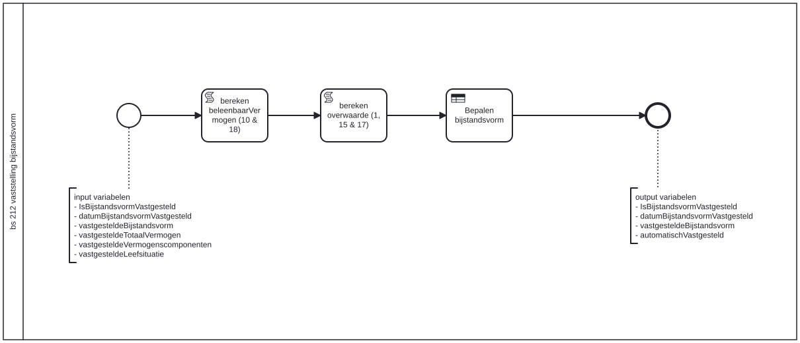

# BS 212 Vaststelling bijstandsvorm

Bouwblok `bs-212-vaststelling-bijstandsvorm`.

## Invoer en uitvoer

**Invoer**

* `IsBijstandsvormVastgesteld`
* `datumBijstandsvormVastgesteld`
* `vastgesteldeBijstandsvorm`
* `vastgesteldeTotaalVermogen`
* `vastgesteldeVermogenscomponenten`
* `vastgesteldeLeefsituatie`

**Uitvoer**

* `IsBijstandsvormVastgesteld`
* `datumBijstandsvormVastgesteld`
* `vastgesteldeBijstandsvorm`
* `automatischVastgesteld`

## Het procesmodel

Gegenereerd uit het BPMN-model. Open de afbeelding apart om in te zoomen.

## Het proces

| Soort | Stap |
| --- | --- |
| Systeemstap | bereken beleenbaarVermogen (10 & 18) |
| Beslistabel | Bepalen bijstandsvorm |
| Systeemstap | bereken overwaarde (1, 15 & 17) |

## Onderdelen

**Beslistabellen**

* `bs-212-vaststelling-bijstandsvorm`

Dit bouwblok heeft een eigen documentdefinitie.

---

Terug naar [Business services](../business-services.md).
