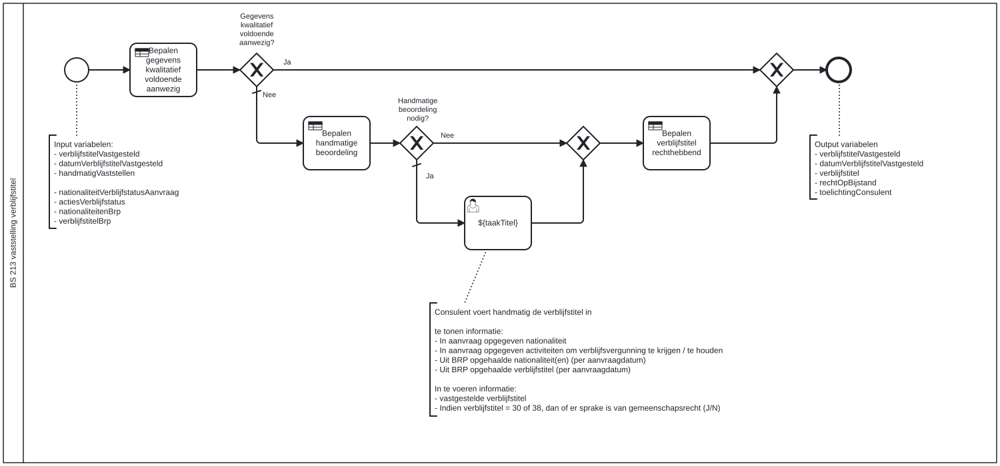

# BS 213 vaststelling verblijfstitel

Bouwblok `bs-213-vaststelling-verblijfstitel`.

## Invoer en uitvoer

**Invoer**

* `verblijfstitelVastgesteld`
* `datumVerblijfstitelVastgesteld`
* `handmatigVaststellen`
* `nationaliteitVerblijfstatusAanvraag`
* `actiesVerblijfstatus`
* `nationaliteitenBrp`
* `verblijfstitelBrp`

**Uitvoer**

* `verblijfstitelVastgesteld`
* `datumVerblijfstitelVastgesteld`
* `verblijfstitel`
* `rechtOpBijstand`
* `toelichtingConsulent`

## Wie roept dit aan

| | |
| --- | --- |
| **Direct aangeroepen door** | `bsb-213-vaststelling-verblijfstitel-aanvrager`, `bsb-213-vaststelling-verblijfstitel-partner` |
| **Binnen zaakproces** | `ab-afhandelen-aanvraag-dcm`, `ioaw-afhandelen-aanvraag-dcm` |

De volledige keten:

* `bs-213-vaststelling-verblijfstitel` ← `bsb-213-vaststelling-verblijfstitel-aanvrager` ← `uitvoeren-business-services` ← `ab-afhandelen-aanvraag-dcm`
* `bs-213-vaststelling-verblijfstitel` ← `bsb-213-vaststelling-verblijfstitel-aanvrager` ← `uitvoeren-business-services` ← `ioaw-afhandelen-aanvraag-dcm`
* `bs-213-vaststelling-verblijfstitel` ← `bsb-213-vaststelling-verblijfstitel-partner` ← `uitvoeren-business-services` ← `ab-afhandelen-aanvraag-dcm`
* `bs-213-vaststelling-verblijfstitel` ← `bsb-213-vaststelling-verblijfstitel-partner` ← `uitvoeren-business-services` ← `ioaw-afhandelen-aanvraag-dcm`

## Het procesmodel

Gegenereerd uit het BPMN-model. Open de afbeelding apart om in te zoomen.

## Het proces

| Soort | Stap |
| --- | --- |
| Beslistabel | Bepalen gegevens kwalitatief voldoende aanwezig |
| Keuze | Gegevens kwalitatief voldoende aanwezig? |
| Beslistabel | Bepalen handmatige beoordeling |
| Keuze | Handmatige beoordeling nodig? |
| Beslistabel | Bepalen verblijfstitel rechthebbend |
| Gebruikerstaak | ${taakTitel} |

## Onderdelen

**Formulieren**

* `bs-213-vaststelling-verblijfstitel.vaststellen-verblijfstitel`

**Beslistabellen**

* `bs-213-vaststelling-verblijfstitel`

Dit bouwblok heeft een eigen documentdefinitie.

---

Terug naar [Business services](../business-services.md).
