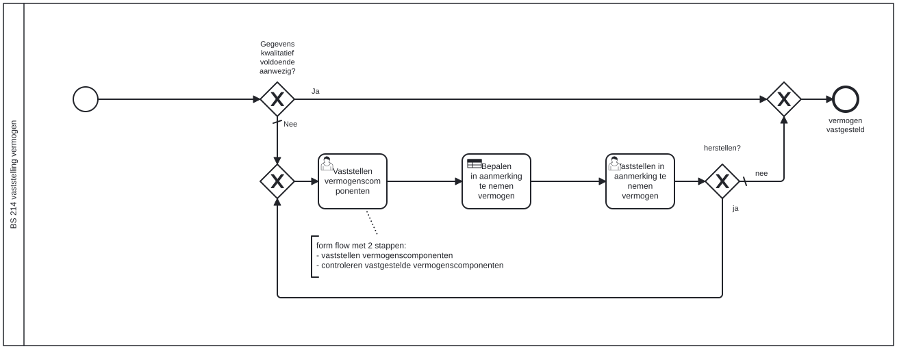

# BS 214 vaststelling vermogen

Bouwblok `bs-214-vaststelling-vermogen`.

## Invoer en uitvoer

Dit bouwblok benoemt geen invoer- en uitvoervariabelen in het procesmodel.

## Wie roept dit aan

| | |
| --- | --- |
| **Direct aangeroepen door** | `bsb-214-vaststelling-vermogen` |
| **Binnen zaakproces** | Algemene bijstand aanvraag, IOAW aanvraag |

De volledige keten, met de technische procesnamen:

* `bs-214-vaststelling-vermogen` ← `bsb-214-vaststelling-vermogen` ← `uitvoeren-business-services` ← `ab-afhandelen-aanvraag-dcm`
* `bs-214-vaststelling-vermogen` ← `bsb-214-vaststelling-vermogen` ← `uitvoeren-business-services` ← `ioaw-afhandelen-aanvraag-dcm`

## Het procesmodel

Gegenereerd uit het BPMN-model. Open de afbeelding apart om in te zoomen.

## Het proces

| Soort | Stap |
| --- | --- |
| Keuze | Gegevens kwalitatief voldoende aanwezig? |
| Gebruikerstaak | Vaststellen vermogenscomponenten |
| Gebruikerstaak | Vaststellen in aanmerking te nemen vermogen |
| Keuze | herstellen? |
| Einde | vermogen vastgesteld |
| Beslistabel | Bepalen in aanmerking te nemen vermogen |

## Onderdelen

**Formulieren**

* `bs-214-controleren-vastgesteld-vermogen`
* `bs-214-vaststellen-bankrekeningen`
* `bs-214-vaststellen-bezittingen`
* `bs-214-vaststellen-eigen-woning`
* `bs-214-vaststellen-schuld`
* `bs-214-vaststelling-aanmerking-vermogen`

**Formulierstromen**

* `bs-214-vaststelling-vermogenscomponenten`

**Beslistabellen**

* `bs-214-vaststelling-vermogen`

Dit bouwblok heeft een eigen documentdefinitie.

---

Terug naar [Business services](../business-services.md).
