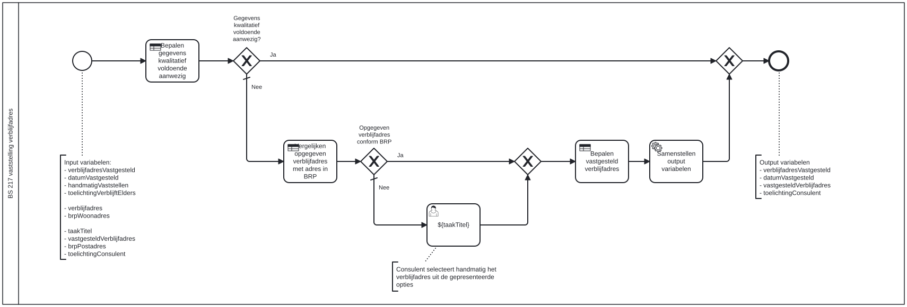

# BS 217 vaststelling verblijfadres

Bouwblok `bs-217-vaststelling-verblijfadres`.

## Invoer en uitvoer

**Invoer**

* `verblijfadresVastgesteld`
* `datumVastgesteld`
* `handmatigVaststellen`
* `toelichtingVerblijftElders`
* `verblijfadres`
* `brpWoonadres`
* `taakTitel`
* `vastgesteldVerblijfadres`
* `brpPostadres`
* `toelichtingConsulent`

**Uitvoer**

* `verblijfadresVastgesteld`
* `datumVastgesteld`
* `vastgesteldVerblijfadres`
* `toelichtingConsulent`

## Het procesmodel

Gegenereerd uit het BPMN-model. Open de afbeelding apart om in te zoomen.

## Het proces

| Soort | Stap |
| --- | --- |
| Beslistabel | Vergelijken opgegeven verblijfadres met adres in BRP |
| Beslistabel | Bepalen gegevens kwalitatief voldoende aanwezig |
| Beslistabel | Bepalen vastgesteld verblijfadres |
| Keuze | Opgegeven verblijfadres conform BRP |
| Keuze | Gegevens kwalitatief voldoende aanwezig? |
| Systeemstap | Samenstellen output variabelen |
| Gebruikerstaak | ${taakTitel} |

## Onderdelen

**Formulieren**

* `bs-217-vaststelling-verblijfadres.selecteren-verblijfadres`

**Beslistabellen**

* `bs-217-vaststelling-verblijfadres`

Dit bouwblok heeft een eigen documentdefinitie.

---

Terug naar [Business services](../business-services.md).
