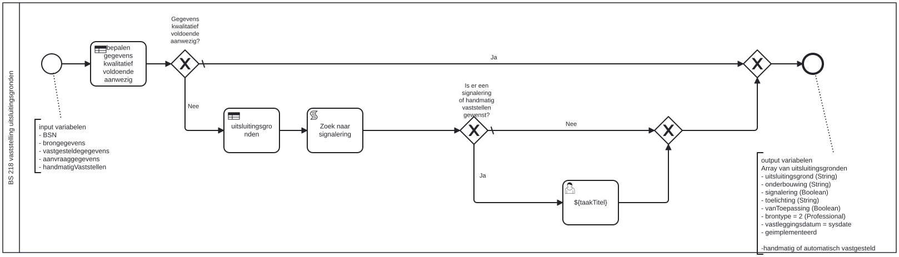

# BS 218 vaststelling uitsluitingsgronden

Bouwblok `bs-218-vaststelling-uitsluitingsgronden`.

## Invoer en uitvoer

**Invoer**

* `BSN`
* `brongegevens`
* `vastgesteldegegevens`
* `aanvraaggegevens`
* `handmatigVaststellen`

**Uitvoer**

* `uitsluitingsgrond (String)`
* `onderbouwing (String)`
* `signalering (Boolean)`
* `toelichting (String)`
* `vanToepassing (Boolean)`
* `brontype = 2 (Professional)`
* `vastleggingsdatum = sysdate`
* `geimplementeerd`
* `handmatig of automatisch vastgesteld`

## Wie roept dit aan

| | |
| --- | --- |
| **Direct aangeroepen door** | `bsb-218-vaststelling-uitsluitingsgronden-aanvrager`, `bsb-218-vaststelling-uitsluitingsgronden-partner` |
| **Binnen zaakproces** | Algemene bijstand aanvraag, IOAW aanvraag |

De volledige keten, met de technische procesnamen:

* `bs-218-vaststelling-uitsluitingsgronden` ← `bsb-218-vaststelling-uitsluitingsgronden-aanvrager` ← `uitvoeren-business-services` ← `ab-afhandelen-aanvraag-dcm`
* `bs-218-vaststelling-uitsluitingsgronden` ← `bsb-218-vaststelling-uitsluitingsgronden-aanvrager` ← `uitvoeren-business-services` ← `ioaw-afhandelen-aanvraag-dcm`
* `bs-218-vaststelling-uitsluitingsgronden` ← `bsb-218-vaststelling-uitsluitingsgronden-partner` ← `uitvoeren-business-services` ← `ab-afhandelen-aanvraag-dcm`
* `bs-218-vaststelling-uitsluitingsgronden` ← `bsb-218-vaststelling-uitsluitingsgronden-partner` ← `uitvoeren-business-services` ← `ioaw-afhandelen-aanvraag-dcm`

## Het procesmodel

Gegenereerd uit het BPMN-model. Open de afbeelding apart om in te zoomen.

## Het proces

| Soort | Stap |
| --- | --- |
| Beslistabel | uitsluitingsgronden |
| Keuze | Gegevens kwalitatief voldoende aanwezig? |
| Beslistabel | bepalen gegevens kwalitatief voldoende aanwezig |
| Systeemstap | Zoek naar signalering |
| Keuze | Is er een signalering of handmatig vaststellen gewenst? |
| Gebruikerstaak | ${taakTitel} |

## Onderdelen

**Formulieren**

* `bs-218-vaststellen-uitsluitingsgronden`

**Beslistabellen**

* `bs-218-vaststelling-uitsluitingsgronden`

Dit bouwblok heeft een eigen documentdefinitie.

---

Terug naar [Business services](../business-services.md).
