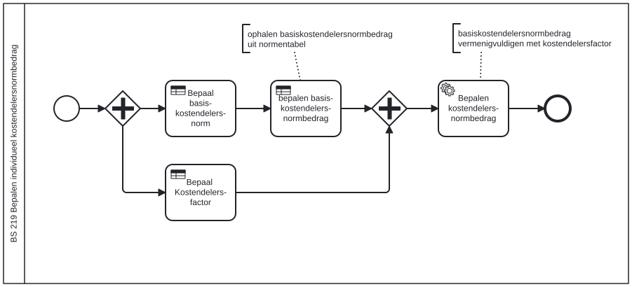

# BS 219 Bepalen individueel kostendelersnormbedrag

Bouwblok `bs-219-bepalen-individueel-kostendelersnormbedrag`.

## Invoer en uitvoer

Dit bouwblok benoemt geen invoer- en uitvoervariabelen in het procesmodel.

## Wie roept dit aan

| | |
| --- | --- |
| **Direct aangeroepen door** | `bs-219-vaststelling-norm` |
| **Binnen zaakproces** | Algemene bijstand aanvraag, IOAW aanvraag |

De volledige keten, met de technische procesnamen:

* `bs-219-bepalen-individueel-kostendelersnormbedrag` ← `bs-219-vaststelling-norm` ← `bsb-219-vaststelling-norm` ← `uitvoeren-business-services` ← `ab-afhandelen-aanvraag-dcm`
* `bs-219-bepalen-individueel-kostendelersnormbedrag` ← `bs-219-vaststelling-norm` ← `bsb-219-vaststelling-norm` ← `uitvoeren-business-services` ← `ioaw-afhandelen-aanvraag-dcm`

## Het procesmodel

Gegenereerd uit het BPMN-model. Open de afbeelding apart om in te zoomen.

## Het proces

| Soort | Stap |
| --- | --- |
| Beslistabel | Bepaal basis-kostendelers-norm |
| Beslistabel | Bepaal  Kostendelers-factor |
| Beslistabel | bepalen basis-kostendelers-normbedrag |
| Systeemstap | Bepalen kostendelers-normbedrag |

## Onderdelen

**Beslistabellen**

* `bs-219-bepalen-basisnormbedrag`
* `bs-219-vaststelling-norm`

Dit bouwblok heeft een eigen documentdefinitie.

---

Terug naar [Business services](../business-services.md).
