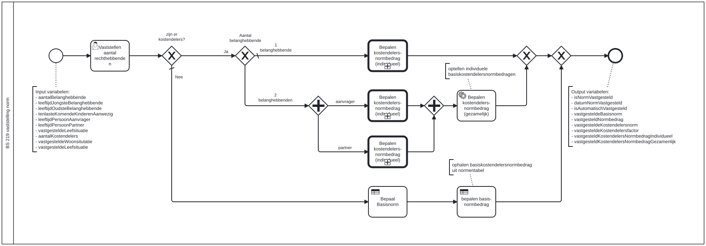

# BS 219 vaststelling norm

Bouwblok `bs-219-vaststelling-norm`.

## Invoer en uitvoer

**Invoer**

* `aantalBelanghebbende`
* `leeftijdJongsteBelanghebbende`
* `leeftijdOudsteBelanghebbende`
* `tenlasteKomendeKinderenAanwezig`
* `leeftijdPersoonAanvrager`
* `leeftijdPersoonPartner`
* `vastgesteldeLeefsituatie`
* `aantalKostendelers`
* `vastgesteldeWoonsitutatie`

**Uitvoer**

* `isNormVastgesteld`
* `datumNormVastgesteld`
* `isAutomatischVastgesteld`
* `vastgesteldeBasisnorm`
* `vastgesteldNormbedrag`
* `vastgesteldeKostendelersnorm`
* `vastgesteldeKostendelersfactor`
* `vastgesteldKostendelersNormbedragIndividueel`
* `vastgesteldKostendelersNormbedragGezamenlijk`

## Wie roept dit aan

| | |
| --- | --- |
| **Direct aangeroepen door** | `bsb-219-vaststelling-norm` |
| **Binnen zaakproces** | `ab-afhandelen-aanvraag-dcm`, `ioaw-afhandelen-aanvraag-dcm` |

De volledige keten:

* `bs-219-vaststelling-norm` ← `bsb-219-vaststelling-norm` ← `uitvoeren-business-services` ← `ab-afhandelen-aanvraag-dcm`
* `bs-219-vaststelling-norm` ← `bsb-219-vaststelling-norm` ← `uitvoeren-business-services` ← `ioaw-afhandelen-aanvraag-dcm`

## Het procesmodel

Gegenereerd uit het BPMN-model. Open de afbeelding apart om in te zoomen.

## Het proces

| Soort | Stap |
| --- | --- |
| Keuze | zijn er kostendelers? |
| Beslistabel | bepalen basis-normbedrag |
| Aanroep | Bepalen kostendelers-normbedrag (individueel) → `bs-219-bepalen-individueel-kostendelersnormbedrag` |
| Beslistabel | Bepaal Basisnorm |
| Aanroep | Bepalen kostendelers-normbedrag (individueel) → `bs-219-bepalen-individueel-kostendelersnormbedrag` |
| Aanroep | Bepalen kostendelers-normbedrag (individueel) → `bs-219-bepalen-individueel-kostendelersnormbedrag` |
| Keuze | Aantal belanghebbende |
| Systeemstap | Bepalen kostendelers-normbedrag (gezamelijk) |
| Gebruikerstaak | Vaststellen aantal rechthebbenden |

## Onderdelen

**Formulieren**

* `bs-219-vaststellen-norm.vaststellen-aantal-rechthebbenden`

**Beslistabellen**

* `bs-219-bepalen-basisnormbedrag`
* `bs-219-vaststelling-norm`

Dit bouwblok heeft een eigen documentdefinitie.

---

Terug naar [Business services](../business-services.md).
