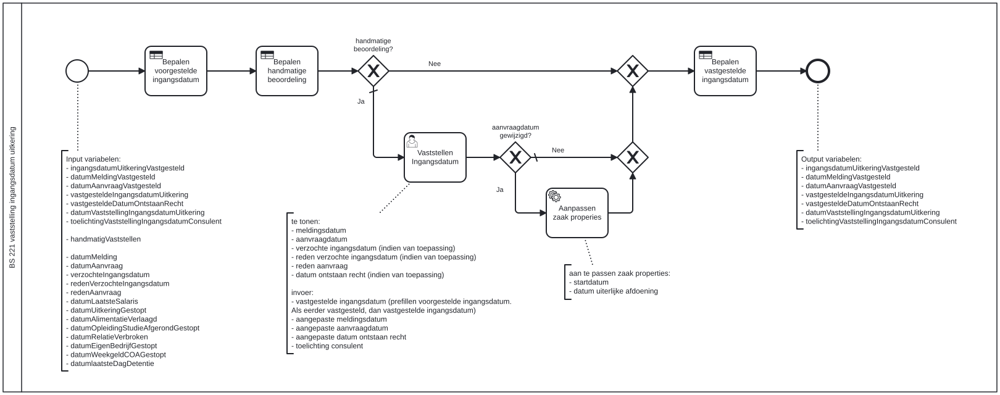

# BS 221 Vaststelling Ingangdatum

Bouwblok `bs-221-vaststelling-ingangsdatum-uitkering`.

## Invoer en uitvoer

**Invoer**

* `ingangsdatumUitkeringVastgesteld`
* `datumMeldingVastgesteld`
* `datumAanvraagVastgesteld`
* `vastgesteldeIngangsdatumUitkering`
* `vastgesteldeDatumOntstaanRecht`
* `datumVaststellingIngangsdatumUitkering`
* `toelichtingVaststellingIngangsdatumConsulent`
* `handmatigVaststellen`
* `datumMelding`
* `datumAanvraag`
* `verzochteIngangsdatum`
* `redenVerzochteIngangsdatum`
* `redenAanvraag`
* `datumLaatsteSalaris`
* `datumUitkeringGestopt`
* `datumAlimentatieVerlaagd`
* `datumOpleidingStudieAfgerondGestopt`
* `datumRelatieVerbroken`
* `datumEigenBedrijfGestopt`
* `datumWeekgeldCOAGestopt`
* `datumlaatsteDagDetentie`

**Uitvoer**

* `ingangsdatumUitkeringVastgesteld`
* `datumMeldingVastgesteld`
* `datumAanvraagVastgesteld`
* `vastgesteldeIngangsdatumUitkering`
* `vastgesteldeDatumOntstaanRecht`
* `datumVaststellingIngangsdatumUitkering`
* `toelichtingVaststellingIngangsdatumConsulent`

## Wie roept dit aan

| | |
| --- | --- |
| **Direct aangeroepen door** | `bsb-221-vaststelling-ingangsdatum` |
| **Binnen zaakproces** | `ab-afhandelen-aanvraag-dcm`, `ioaw-afhandelen-aanvraag-dcm` |

De volledige keten:

* `bs-221-vaststelling-ingangsdatum-uitkering` ← `bsb-221-vaststelling-ingangsdatum` ← `uitvoeren-business-services` ← `ab-afhandelen-aanvraag-dcm`
* `bs-221-vaststelling-ingangsdatum-uitkering` ← `bsb-221-vaststelling-ingangsdatum` ← `uitvoeren-business-services` ← `ioaw-afhandelen-aanvraag-dcm`

## Het procesmodel

Gegenereerd uit het BPMN-model. Open de afbeelding apart om in te zoomen.

## Het proces

| Soort | Stap |
| --- | --- |
| Beslistabel | Bepalen voorgestelde ingangsdatum |
| Beslistabel | Bepalen handmatige beoordeling |
| Keuze | handmatige beoordeling? |
| Keuze | aanvraagdatum gewijzigd? |
| Gebruikerstaak | Vaststellen Ingangsdatum |
| Systeemstap | Aanpassen zaak properies |
| Beslistabel | Bepalen vastgestelde ingangsdatum |

## Onderdelen

**Formulieren**

* `bs-221-vaststelling-ingangsdatum`

**Beslistabellen**

* `bs-221-vaststelling-ingangsdatum-uitkering`

Dit bouwblok heeft een eigen documentdefinitie.

---

Terug naar [Business services](../business-services.md).
