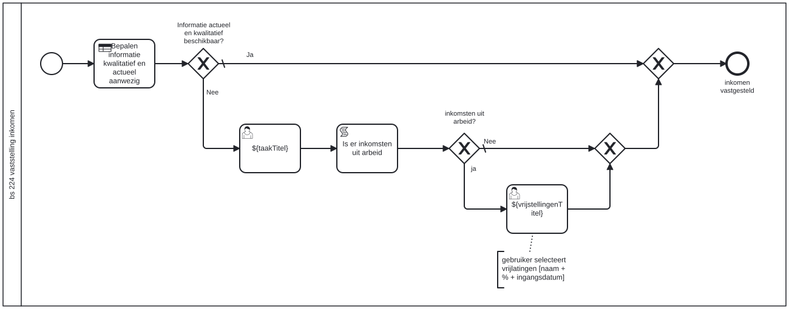

# BS 224 vaststelling inkomen

Bouwblok `bs-224-vaststelling-inkomen`.

## Invoer en uitvoer

Dit bouwblok benoemt geen invoer- en uitvoervariabelen in het procesmodel.

## Wie roept dit aan

| | |
| --- | --- |
| **Direct aangeroepen door** | `bsb-224-vaststelling-inkomen-aanvrager`, `bsb-224-vaststelling-inkomen-partner` |
| **Binnen zaakproces** | `ab-afhandelen-aanvraag-dcm`, `ioaw-afhandelen-aanvraag-dcm` |

De volledige keten:

* `bs-224-vaststelling-inkomen` ← `bsb-224-vaststelling-inkomen-aanvrager` ← `uitvoeren-business-services` ← `ab-afhandelen-aanvraag-dcm`
* `bs-224-vaststelling-inkomen` ← `bsb-224-vaststelling-inkomen-aanvrager` ← `uitvoeren-business-services` ← `ioaw-afhandelen-aanvraag-dcm`
* `bs-224-vaststelling-inkomen` ← `bsb-224-vaststelling-inkomen-partner` ← `uitvoeren-business-services` ← `ab-afhandelen-aanvraag-dcm`
* `bs-224-vaststelling-inkomen` ← `bsb-224-vaststelling-inkomen-partner` ← `uitvoeren-business-services` ← `ioaw-afhandelen-aanvraag-dcm`

## Het procesmodel

Gegenereerd uit het BPMN-model. Open de afbeelding apart om in te zoomen.

## Het proces

| Soort | Stap |
| --- | --- |
| Beslistabel | Bepalen informatie kwalitatief en actueel aanwezig |
| Keuze | Informatie actueel en kwalitatief beschikbaar? |
| Gebruikerstaak | ${taakTitel} |
| Keuze | inkomsten uit arbeid? |
| Gebruikerstaak | ${vrijstellingenTitel} |
| Systeemstap | Is er inkomsten uit arbeid |
| Einde | inkomen vastgesteld |

## Onderdelen

**Formulieren**

* `bs-224-controleren-vastgesteld-inkomen`
* `bs-224-vaststellen-inkomen`
* `bs-224-vaststellen-inkomsten-uit-arbeid`
* `bs-224-vaststellen-inkomsten-uit-onderneming`
* `bs-224-vaststellen-inkomsten-uitkering-pensioen-stufi`
* `bs-224-vaststellen-mogelijke-vrijlatingen`
* `bs-224-vaststellen-overige-inkomsten`

**Formulierstromen**

* `bs-224-vaststelling-inkomen`

**Beslistabellen**

* `bs-224-vaststelling-inkomen`

Dit bouwblok heeft een eigen documentdefinitie.

---

Terug naar [Business services](../business-services.md).
