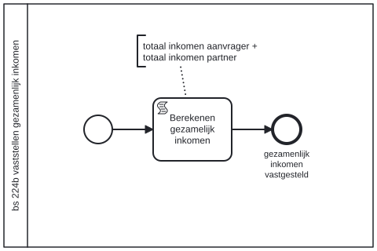

# BS 224b vaststellen gezamenlijk inkomen

Bouwblok `bs-224b-vaststellen-gezamenlijk-inkomen`.

## Invoer en uitvoer

Dit bouwblok benoemt geen invoer- en uitvoervariabelen in het procesmodel.

## Het procesmodel

Gegenereerd uit het BPMN-model. Open de afbeelding apart om in te zoomen.

## Het proces

| Soort | Stap |
| --- | --- |
| Systeemstap | Berekenen gezamelijk inkomen |
| Einde | gezamenlijk inkomen vastgesteld |

## Onderdelen

Dit bouwblok heeft een eigen documentdefinitie.

---

Terug naar [Business services](../business-services.md).
