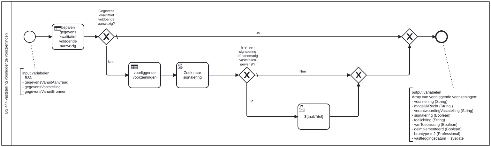

# BS 444 vaststelling voorliggende voorzieningen

Bouwblok `bs-444-vaststelling-voorliggende-voorzieningen`.

## Invoer en uitvoer

**Invoer**

* `BSN`
* `gegevensVanuitAanvraag`
* `gegevensVaststelling`
* `gegevensVanuitBronnen`

**Uitvoer**

* `voorziening (String)`
* `mogelijkRecht (String )`
* `verantwoordingVaststelling (String)`
* `signalering (Boolean)`
* `toelichting (String)`
* `vanToepassing (Boolean)`
* `geimplementeerd (Boolean)`
* `brontype = 2 (Professional)`
* `vastleggingsdatum = sysdate`

## Wie roept dit aan

| | |
| --- | --- |
| **Direct aangeroepen door** | `bsb-444-vaststelling-voorliggende-voorzieningen-aanvrager`, `bsb-444-vaststelling-voorliggende-voorzieningen-partner` |
| **Binnen zaakproces** | Algemene bijstand aanvraag, IOAW aanvraag |

De volledige keten, met de technische procesnamen:

* `bs-444-vaststelling-voorliggende-voorzieningen` ← `bsb-444-vaststelling-voorliggende-voorzieningen-aanvrager` ← `uitvoeren-business-services` ← `ab-afhandelen-aanvraag-dcm`
* `bs-444-vaststelling-voorliggende-voorzieningen` ← `bsb-444-vaststelling-voorliggende-voorzieningen-aanvrager` ← `uitvoeren-business-services` ← `ioaw-afhandelen-aanvraag-dcm`
* `bs-444-vaststelling-voorliggende-voorzieningen` ← `bsb-444-vaststelling-voorliggende-voorzieningen-partner` ← `uitvoeren-business-services` ← `ab-afhandelen-aanvraag-dcm`
* `bs-444-vaststelling-voorliggende-voorzieningen` ← `bsb-444-vaststelling-voorliggende-voorzieningen-partner` ← `uitvoeren-business-services` ← `ioaw-afhandelen-aanvraag-dcm`

## Het procesmodel

Gegenereerd uit het BPMN-model. Open de afbeelding apart om in te zoomen.

## Het proces

| Soort | Stap |
| --- | --- |
| Beslistabel | voorliggende voorzieningen |
| Keuze | Gegevens kwalitatief voldoende aanwezig? |
| Beslistabel | bepalen gegevens kwalitatief voldoende aanwezig |
| Keuze | Is er een signalering of handmatig vaststellen gewenst? |
| Gebruikerstaak | ${taakTitel} |
| Systeemstap | Zoek naar signalering |

## Onderdelen

**Formulieren**

* `bs-444-vaststellen-voorliggende-voorzieningen`

**Beslistabellen**

* `bs-444-vaststelling-voorliggende-voorzieningen`

Dit bouwblok heeft een eigen documentdefinitie.

---

Terug naar [Business services](../business-services.md).
