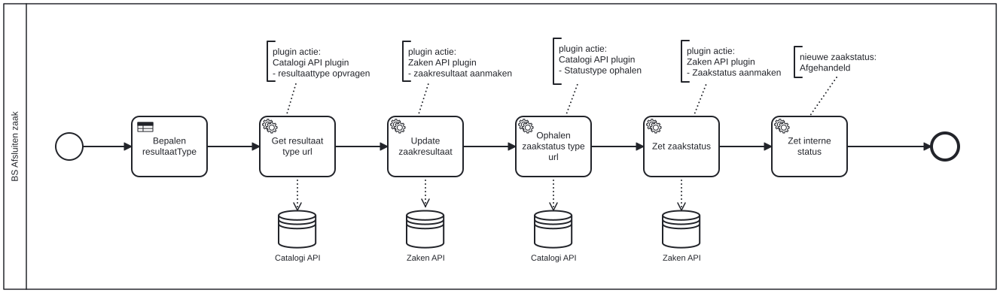

# BS Afsluiten zaak

Bouwblok `bs-afsluiten-zaak`.

## Invoer en uitvoer

Dit bouwblok benoemt geen invoer- en uitvoervariabelen in het procesmodel.

## Wie roept dit aan

| | |
| --- | --- |
| **Direct aangeroepen door** | `basisafhandelproces-bsb-afsluiten-zaak`, `bsb-afsluiten-zaak` |
| **Binnen zaakproces** | Algemene bijstand aanvraag, Basisafhandelproces, IOAW aanvraag |

De volledige keten, met de technische procesnamen:

* `bs-afsluiten-zaak` ← `basisafhandelproces-bsb-afsluiten-zaak` ← `basisafhandelproces-uitvoeren-business-services` ← `basisafhandelproces-behandelen-zaak` ← `basisafhandelproces-afhandelen-aanvraag`
* `bs-afsluiten-zaak` ← `bsb-afsluiten-zaak` ← `uitvoeren-business-services` ← `ab-afhandelen-aanvraag-dcm`
* `bs-afsluiten-zaak` ← `bsb-afsluiten-zaak` ← `uitvoeren-business-services` ← `ioaw-afhandelen-aanvraag-dcm`

## Het procesmodel

Gegenereerd uit het BPMN-model. Open de afbeelding apart om in te zoomen.

## Het proces

| Soort | Stap |
| --- | --- |
| Systeemstap | Get resultaat type url |
| Systeemstap | Update zaakresultaat |
| dataStoreReference | Zaken API |
| dataStoreReference | Catalogi API |
| Systeemstap | Ophalen zaakstatus type url |
| Systeemstap | Zet zaakstatus |
| dataStoreReference | Catalogi API |
| dataStoreReference | Zaken API |
| Beslistabel | Bepalen resultaatType |
| Systeemstap | Zet interne status |

## Onderdelen

**Beslistabellen**

* `alo-bepalen-resultaattype`

Dit bouwblok heeft een eigen documentdefinitie.

---

Terug naar [Business services](../business-services.md).
