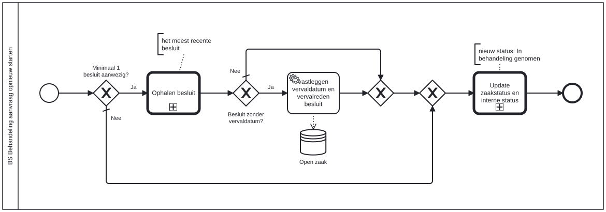

# BS Behandeling aanvraag opnieuw starten

Bouwblok `bs-behandeling-aanvraag-opnieuw-starten`.

## Invoer en uitvoer

Dit bouwblok benoemt geen invoer- en uitvoervariabelen in het procesmodel.

## Wie roept dit aan

| | |
| --- | --- |
| **Direct aangeroepen door** | `bsb-behandeling-aanvraag-opnieuw-starten` |
| **Binnen zaakproces** | Algemene bijstand aanvraag, Basisafhandelproces, IOAW aanvraag |

De volledige keten, met de technische procesnamen:

* `bs-behandeling-aanvraag-opnieuw-starten` ← `bsb-behandeling-aanvraag-opnieuw-starten` ← `basisafhandelproces-uitvoeren-business-services` ← `basisafhandelproces-behandelen-zaak` ← `basisafhandelproces-afhandelen-aanvraag`
* `bs-behandeling-aanvraag-opnieuw-starten` ← `bsb-behandeling-aanvraag-opnieuw-starten` ← `uitvoeren-business-services` ← `ab-afhandelen-aanvraag-dcm`
* `bs-behandeling-aanvraag-opnieuw-starten` ← `bsb-behandeling-aanvraag-opnieuw-starten` ← `uitvoeren-business-services` ← `ioaw-afhandelen-aanvraag-dcm`

## Het procesmodel

Gegenereerd uit het BPMN-model. Open de afbeelding apart om in te zoomen.

## Het proces

| Soort | Stap |
| --- | --- |
| Aanroep | Ophalen besluit → `generic-ophalen-besluit` |
| Keuze | Besluit zonder vervaldatum? |
| Systeemstap | vastleggen vervaldatum en vervalreden besluit |
| dataStoreReference | Open zaak |
| Keuze | Minimaal 1 besluit aanwezig? |
| Aanroep | Update zaakstatus en interne status → `generic-update-zaakstatus-en-interne-status-plugin-v2` |

## Onderdelen

Dit bouwblok heeft een eigen documentdefinitie.

---

Terug naar [Business services](../business-services.md).
