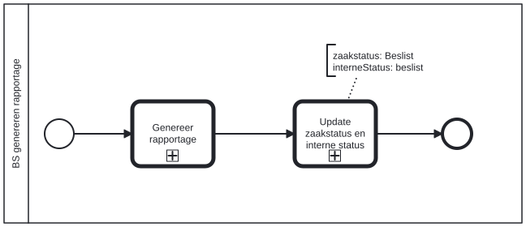

# BS genereren rapportage

Bouwblok `bs-genereren-rapportage`.

## Invoer en uitvoer

Dit bouwblok benoemt geen invoer- en uitvoervariabelen in het procesmodel.

## Wie roept dit aan

| | |
| --- | --- |
| **Direct aangeroepen door** | `bsb-genereren-rapportage` |
| **Binnen zaakproces** | `ab-afhandelen-aanvraag-dcm`, `ioaw-afhandelen-aanvraag-dcm` |

De volledige keten:

* `bs-genereren-rapportage` ← `bsb-genereren-rapportage` ← `uitvoeren-business-services` ← `ab-afhandelen-aanvraag-dcm`
* `bs-genereren-rapportage` ← `bsb-genereren-rapportage` ← `uitvoeren-business-services` ← `ioaw-afhandelen-aanvraag-dcm`

## Het procesmodel

Gegenereerd uit het BPMN-model. Open de afbeelding apart om in te zoomen.

## Het proces

| Soort | Stap |
| --- | --- |
| Aanroep | Update zaakstatus en interne status → `generic-update-zaakstatus-en-interne-status-plugin-v2` |
| Aanroep | Genereer rapportage → `alo-genereer-rapportage` |

## Onderdelen

Dit bouwblok heeft een eigen documentdefinitie.

---

Terug naar [Business services](../business-services.md).
