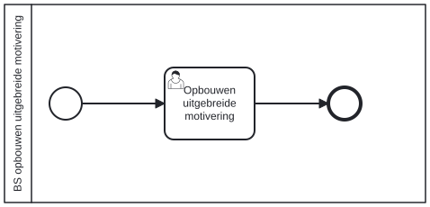

# BS opbouwen uitgebreide motivering

Bouwblok `bs-opbouwen-uitgebreide-motivering`.

## Invoer en uitvoer

Dit bouwblok benoemt geen invoer- en uitvoervariabelen in het procesmodel.

## Het procesmodel

Gegenereerd uit het BPMN-model. Open de afbeelding apart om in te zoomen.

## Het proces

| Soort | Stap |
| --- | --- |
| Gebruikerstaak | Opbouwen uitgebreide motivering |

## Onderdelen

**Formulieren**

* `bs-opbouwen-uitgebreide-motivering.opbouwen-uitgebreide-motivering`

Dit bouwblok heeft een eigen documentdefinitie.

---

Terug naar [Business services](../business-services.md).
