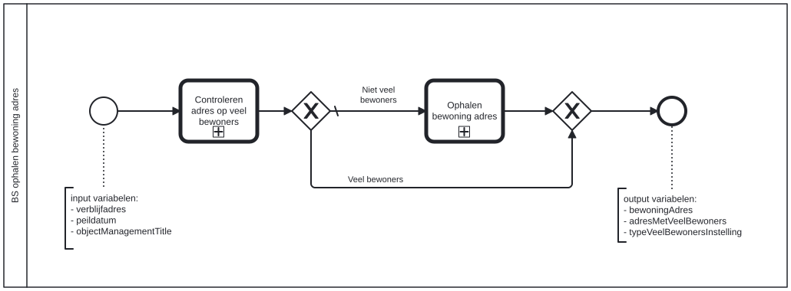

# BS ophalen bewoning adres

Bouwblok `bs-ophalen-bewoning-adres`.

## Invoer en uitvoer

**Invoer**

* `verblijfadres`
* `peildatum`
* `objectManagementTitle`

**Uitvoer**

* `bewoningAdres`
* `adresMetVeelBewoners`
* `typeVeelBewonersInstelling`

## Het procesmodel

Gegenereerd uit het BPMN-model. Open de afbeelding apart om in te zoomen.

## Het proces

| Soort | Stap |
| --- | --- |
| Aanroep | Controleren adres op veel bewoners → `controleren-adres-veel-bewoners` |
| Aanroep | Ophalen bewoning adres → `ophalen-brp-bewoningen-gegevens` |

## Onderdelen

Dit bouwblok heeft een eigen documentdefinitie.

---

Terug naar [Business services](../business-services.md).
