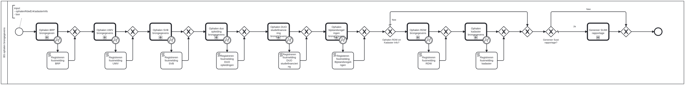

# BS ophalen brongegevens

Bouwblok `bs-ophalen-brongegevens`.

## Invoer en uitvoer

**Invoer**

* `ophalenRdwEnKadasterInfo`
* `bsn`

## Wie roept dit aan

| | |
| --- | --- |
| **Direct aangeroepen door** | `bsb-ophalen-brongegevens-aanvrager`, `bsb-ophalen-brongegevens-partner` |
| **Binnen zaakproces** | Algemene bijstand aanvraag, IOAW aanvraag |

De volledige keten, met de technische procesnamen:

* `bs-ophalen-brongegevens` ← `bsb-ophalen-brongegevens-aanvrager` ← `uitvoeren-business-services` ← `ab-afhandelen-aanvraag-dcm`
* `bs-ophalen-brongegevens` ← `bsb-ophalen-brongegevens-aanvrager` ← `uitvoeren-business-services` ← `ioaw-afhandelen-aanvraag-dcm`
* `bs-ophalen-brongegevens` ← `bsb-ophalen-brongegevens-partner` ← `uitvoeren-business-services` ← `ab-afhandelen-aanvraag-dcm`
* `bs-ophalen-brongegevens` ← `bsb-ophalen-brongegevens-partner` ← `uitvoeren-business-services` ← `ioaw-afhandelen-aanvraag-dcm`

## Het procesmodel

Gegenereerd uit het BPMN-model. Open de afbeelding apart om in te zoomen.

## Het proces

| Soort | Stap |
| --- | --- |
| Aanroep | Ophalen BRP brongegeven → `generic-suwinet-ophalen-brp-brongegevens` |
| Systeemstap | Registreren foutmelding BRP |
| Aanroep | Ophalen UWV brongegevens → `generic-suwinet-ophalen-uwv-brongegevens` |
| Systeemstap | Registreren foutmelding UWV |
| Aanroep | Ophalen SVB brongegevens → `generic-suwinet-ophalen-svb-uitkeringen` |
| Systeemstap | Registreren foutmelding SVB |
| Aanroep | Ophalen duo opleiding brongegevens → `generic-suwinet-ophalen-duo-opleiding-brongegevens` |
| Systeemstap | Registreren foutmelding DUO opleidingen |
| Aanroep | Ophalen DUO studiefinanciering brongegevens → `generic-suwinet-ophalen-duo-studiefinanciering-info` |
| Systeemstap | Registreren foutmelding DUO studiefinanciering |
| Aanroep | Ophalen bijstandsregelingen brongegevens → `generic-suwinet-ophalen-bijstandsregelingen` |
| Systeemstap | Registeren foutmelding Bijstandsregelingen |
| Keuze | Ophalen RDW en Kadaster Info? |
| Aanroep | Ophalen RDW brongegevens → `generic-suwinet-ophalen-rdw-brongegevens` |
| Systeemstap | Registreren foutmelding RDW |
| Aanroep | Ophalen kadaster brongegevens → `generic-suwinet-ophalen-kadaster-brongegevens` |
| Systeemstap | Registreren foutmelding kadaster |
| Keuze | Genereer Suwi rapportage? |
| Aanroep | Genereer SUWI rapportage → `alo-genereer-rapportage` |

## Onderdelen

Dit bouwblok heeft een eigen documentdefinitie.

---

Terug naar [Business services](../business-services.md).
