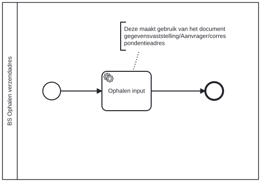

# Ophalen actueel verzendadres

Bouwblok `bs-ophalen-verzendadres`.

## Invoer en uitvoer

Dit bouwblok benoemt geen invoer- en uitvoervariabelen in het procesmodel.

## Wie roept dit aan

| | |
| --- | --- |
| **Direct aangeroepen door** | `bs-overwegen-uitzetten-informatieverzoek` |
| **Binnen zaakproces** | Algemene bijstand aanvraag, IOAW aanvraag |

De volledige keten, met de technische procesnamen:

* `bs-ophalen-verzendadres` ← `bs-overwegen-uitzetten-informatieverzoek` ← `bsb-overwegen-uitzetten-informatieverzoek` ← `uitvoeren-business-services` ← `ab-afhandelen-aanvraag-dcm`
* `bs-ophalen-verzendadres` ← `bs-overwegen-uitzetten-informatieverzoek` ← `bsb-overwegen-uitzetten-informatieverzoek` ← `uitvoeren-business-services` ← `ioaw-afhandelen-aanvraag-dcm`

## Het procesmodel

Gegenereerd uit het BPMN-model. Open de afbeelding apart om in te zoomen.

## Het proces

| Soort | Stap |
| --- | --- |
| Systeemstap | Ophalen input |

## Onderdelen

Dit bouwblok heeft een eigen documentdefinitie.

---

Terug naar [Business services](../business-services.md).
