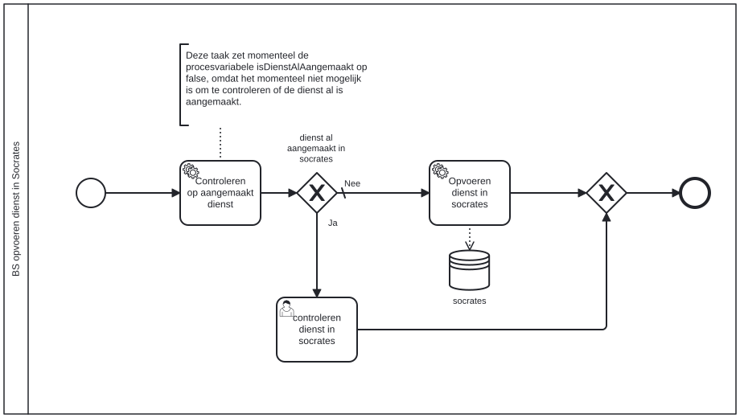

# BS opvoeren dienst in Socrates

Bouwblok `bs-opvoeren-dienst-in-socrates`.

## Invoer en uitvoer

Dit bouwblok benoemt geen invoer- en uitvoervariabelen in het procesmodel.

## Het procesmodel

Gegenereerd uit het BPMN-model. Open de afbeelding apart om in te zoomen.

## Het proces

| Soort | Stap |
| --- | --- |
| Keuze | dienst al aangemaakt in socrates |
| Gebruikerstaak | controleren dienst in socrates |
| Systeemstap | Controleren op aangemaakt dienst |
| Systeemstap | Opvoeren dienst in socrates |
| dataStoreReference | socrates |

## Onderdelen

**Formulieren**

* `aanvraag-levensonderhoud.controleren-dienst-in-socrates`

Dit bouwblok heeft een eigen documentdefinitie.

---

Terug naar [Business services](../business-services.md).
