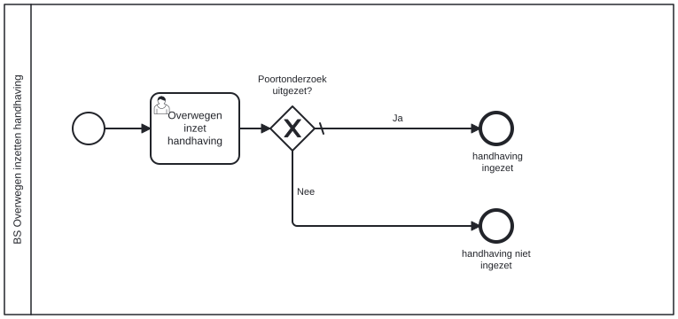

# BS Overwegen inzetten handhaving

Bouwblok `bs-overwegen-inzetten-handhaving`.

## Invoer en uitvoer

Dit bouwblok benoemt geen invoer- en uitvoervariabelen in het procesmodel.

## Wie roept dit aan

| | |
| --- | --- |
| **Direct aangeroepen door** | `bsb-overwegen-inzetten-handhaving` |
| **Binnen zaakproces** | Algemene bijstand aanvraag, IOAW aanvraag |

De volledige keten, met de technische procesnamen:

* `bs-overwegen-inzetten-handhaving` ← `bsb-overwegen-inzetten-handhaving` ← `uitvoeren-business-services` ← `ab-afhandelen-aanvraag-dcm`
* `bs-overwegen-inzetten-handhaving` ← `bsb-overwegen-inzetten-handhaving` ← `uitvoeren-business-services` ← `ioaw-afhandelen-aanvraag-dcm`

## Het procesmodel

Gegenereerd uit het BPMN-model. Open de afbeelding apart om in te zoomen.

## Het proces

| Soort | Stap |
| --- | --- |
| Gebruikerstaak | Overwegen inzet handhaving |
| Keuze | Poortonderzoek uitgezet? |
| Einde | handhaving ingezet |
| Einde | handhaving niet ingezet |

## Onderdelen

**Formulieren**

* `bs.overwegen-inzet-handhaving.overwegen-inzet-handhaving`

Dit bouwblok heeft een eigen documentdefinitie.

---

Terug naar [Business services](../business-services.md).
