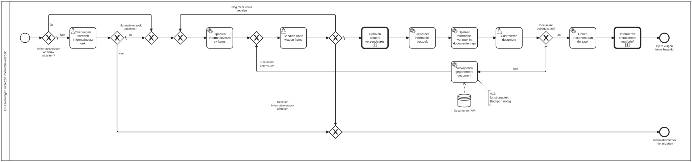

# BS Overwegen uitzetten informatieverzoek

Bouwblok `bs-overwegen-uitzetten-informatieverzoek`.

## Invoer en uitvoer

Dit bouwblok benoemt geen invoer- en uitvoervariabelen in het procesmodel.

## Wie roept dit aan

| | |
| --- | --- |
| **Direct aangeroepen door** | `bsb-overwegen-uitzetten-informatieverzoek` |
| **Binnen zaakproces** | `ab-afhandelen-aanvraag-dcm`, `ioaw-afhandelen-aanvraag-dcm` |

De volledige keten:

* `bs-overwegen-uitzetten-informatieverzoek` ← `bsb-overwegen-uitzetten-informatieverzoek` ← `uitvoeren-business-services` ← `ab-afhandelen-aanvraag-dcm`
* `bs-overwegen-uitzetten-informatieverzoek` ← `bsb-overwegen-uitzetten-informatieverzoek` ← `uitvoeren-business-services` ← `ioaw-afhandelen-aanvraag-dcm`

## Het procesmodel

Gegenereerd uit het BPMN-model. Open de afbeelding apart om in te zoomen.

## Het proces

| Soort | Stap |
| --- | --- |
| Gebruikerstaak | Overwegen uitzetten informatieverzoek |
| Keuze | Informatieverzoek opnieuw uitzetten? |
| Keuze | Informatieverzoek uitzetten? |
| Systeemstap | Ophalen Informatieverzoek items |
| Keuze | Document afgewezen |
| Gebruikerstaak | Bepalen op te vragen items |
| Systeemstap | Genereer informatie-verzoek |
| Systeemstap | Opslaan informatie-verzoek in documenten api |
| Gebruikerstaak | Controleren document |
| Systeemstap | Linken document aan de zaak |
| Keuze | Document goedgekeurd? |
| Systeemstap | Verwijderen gegenereerd document |
| dataStoreReference | Documenten API |
| Aanroep | Informeren betrokkenen met brief → `generic-informeren-betrokkenen-met-brief` |
| Einde | Op te vragen items bepaald |
| Einde | Informatieverzoek niet uitzetten |
| Aanroep | Ophalen actueel verzendadres → `bs-ophalen-verzendadres` |

## Onderdelen

**Formulieren**

* `bs.overwegen-uitzetten-informatieverzoek.bepalen-op-te-vragen-items`
* `bs.overwegen-uitzetten-informatieverzoek.controleren-document`
* `bs.overwegen-uitzetten-informatieverzoek.overwegen-uitzetten-informatieverzoek`

Dit bouwblok heeft een eigen documentdefinitie.

---

Terug naar [Business services](../business-services.md).
