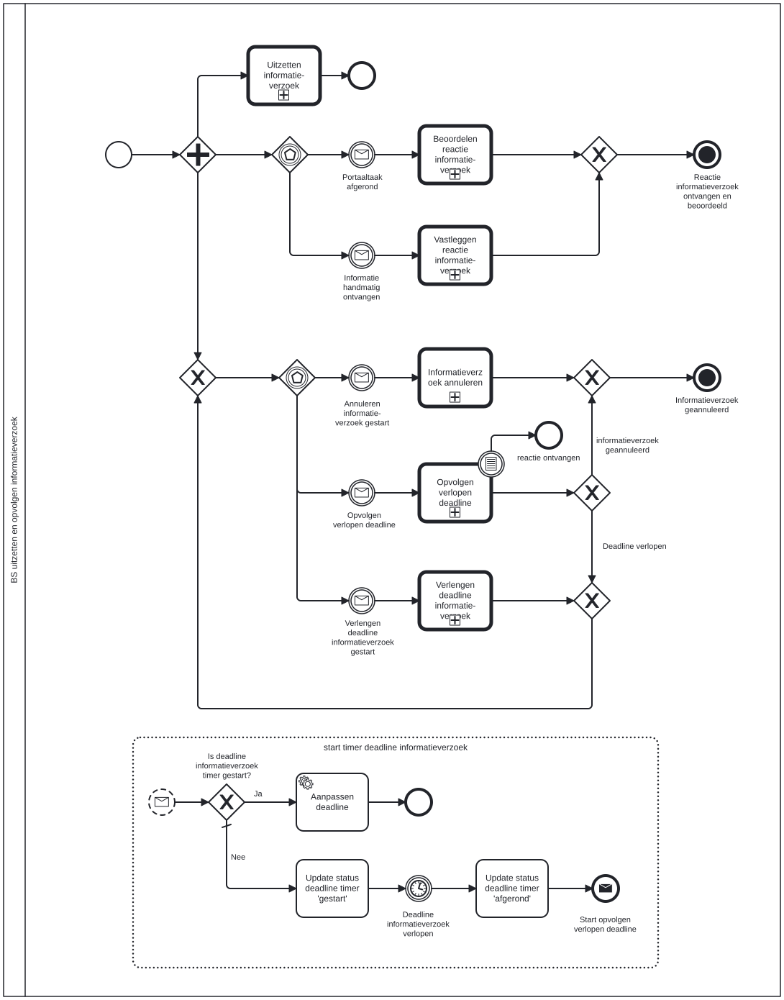

# BS uitzetten en opvolgen informatieverzoek

Bouwblok `bs-uitzetten-en-opvolgen-informatieverzoek`.

## Invoer en uitvoer

Dit bouwblok benoemt geen invoer- en uitvoervariabelen in het procesmodel.

## Wie roept dit aan

| | |
| --- | --- |
| **Direct aangeroepen door** | `bsb-uitzetten-en-opvolgen-informatieverzoek` |
| **Binnen zaakproces** | Algemene bijstand aanvraag, IOAW aanvraag |

De volledige keten, met de technische procesnamen:

* `bs-uitzetten-en-opvolgen-informatieverzoek` ← `bsb-uitzetten-en-opvolgen-informatieverzoek` ← `uitvoeren-business-services` ← `ab-afhandelen-aanvraag-dcm`
* `bs-uitzetten-en-opvolgen-informatieverzoek` ← `bsb-uitzetten-en-opvolgen-informatieverzoek` ← `uitvoeren-business-services` ← `ioaw-afhandelen-aanvraag-dcm`

## Het procesmodel

Gegenereerd uit het BPMN-model. Open de afbeelding apart om in te zoomen.

## Het proces

| Soort | Stap |
| --- | --- |
| Wachtpunt | Informatie handmatig ontvangen |
| Aanroep | Beoordelen reactie informatie-verzoek → `generic-beoordelen-reactie-informatieverzoek` |
| Aanroep | Vastleggen reactie informatie-verzoek → `generic-vastleggen-reactie-informatieverzoek` |
| Wachtpunt | Portaaltaak afgerond |
| Aanroep | Informatieverzoek annuleren → `generic-annuleren-informatieverzoek` |
| Aanroep | Verlengen deadline informatie-verzoek → `generic-verlengen-deadline-informatieverzoek` |
| Aanroep | Opvolgen verlopen deadline → `generic-opvolgen-verlopen-deadline-informatieverzoek` |
| Einde | reactie ontvangen |
| Einde | Informatieverzoek geannuleerd |
| Wachtpunt | Annuleren informatie-verzoek gestart |
| Wachtpunt | Opvolgen verlopen deadline |
| Wachtpunt | Verlengen deadline informatieverzoek gestart |
| Einde | Reactie informatieverzoek ontvangen en beoordeeld |
| Aanroep | Uitzetten informatie-verzoek → `generic-uitzetten-informatieverzoek` |
| Subproces | start timer deadline informatieverzoek |

## Onderdelen

**Formulieren**

* `generic-beoordelen-resultaat-informatieverzoek`
* `generic-vastleggen-reactie-informatieverzoek.uploaden-ontvangen-documenten`
* `generic.opvolgen-verlopen-deadline-informatieverzoek.bepalen-vervolgactie-verlopen-deadline`

Dit bouwblok heeft een eigen documentdefinitie.

---

Terug naar [Business services](../business-services.md).
