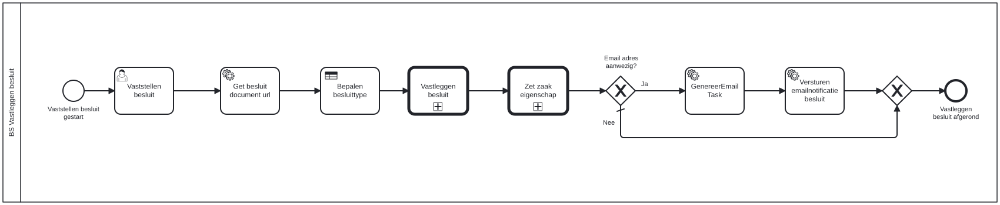

# BS Vastleggen besluit

Bouwblok `bs-vastleggen-besluit`.

## Invoer en uitvoer

Dit bouwblok benoemt geen invoer- en uitvoervariabelen in het procesmodel.

## Wie roept dit aan

| | |
| --- | --- |
| **Direct aangeroepen door** | `bsb-vastleggen-besluit` |
| **Binnen zaakproces** | Algemene bijstand aanvraag, IOAW aanvraag |

De volledige keten, met de technische procesnamen:

* `bs-vastleggen-besluit` ← `bsb-vastleggen-besluit` ← `uitvoeren-business-services` ← `ab-afhandelen-aanvraag-dcm`
* `bs-vastleggen-besluit` ← `bsb-vastleggen-besluit` ← `uitvoeren-business-services` ← `ioaw-afhandelen-aanvraag-dcm`

## Het procesmodel

Gegenereerd uit het BPMN-model. Open de afbeelding apart om in te zoomen.

## Het proces

| Soort | Stap |
| --- | --- |
| Start | Vaststellen besluit gestart |
| Gebruikerstaak | Vaststellen besluit |
| Systeemstap | Get besluit document url |
| Beslistabel | Bepalen besluittype |
| Aanroep | Vastleggen besluit → `generic-vastleggen-besluit` |
| Aanroep | Zet zaak eigenschap → `generic-zet-zaakeigenschap` |
| Keuze | Email adres aanwezig? |
| Systeemstap | Versturen emailnotificatie besluit |
| Einde | Vastleggen besluit afgerond |
| Systeemstap | GenereerEmailTask |

## Onderdelen

**Formulieren**

* `bs.vastleggen-besluit.vaststellen-besluit`

**Beslistabellen**

* `alo-bepaal-besluittype`

Dit bouwblok heeft een eigen documentdefinitie.

---

Terug naar [Business services](../business-services.md).
