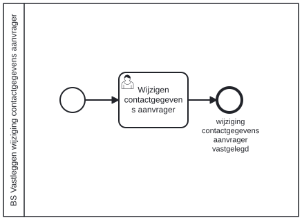

# BS Vastleggen wijziging contactgegevens aanvrager

Bouwblok `bs-vastleggen-wijziging-contactgegevens-aanvrager`.

## Invoer en uitvoer

Dit bouwblok benoemt geen invoer- en uitvoervariabelen in het procesmodel.

## Wie roept dit aan

| | |
| --- | --- |
| **Direct aangeroepen door** | `bsb-vastleggen-wijziging-contactgegevens-aanvrager` |
| **Binnen zaakproces** | `ab-afhandelen-aanvraag-dcm`, `basisafhandelproces-afhandelen-aanvraag`, `ioaw-afhandelen-aanvraag-dcm` |

De volledige keten:

* `bs-vastleggen-wijziging-contactgegevens-aanvrager` ← `bsb-vastleggen-wijziging-contactgegevens-aanvrager` ← `basisafhandelproces-uitvoeren-business-services` ← `basisafhandelproces-behandelen-zaak` ← `basisafhandelproces-afhandelen-aanvraag`
* `bs-vastleggen-wijziging-contactgegevens-aanvrager` ← `bsb-vastleggen-wijziging-contactgegevens-aanvrager` ← `uitvoeren-business-services` ← `ab-afhandelen-aanvraag-dcm`
* `bs-vastleggen-wijziging-contactgegevens-aanvrager` ← `bsb-vastleggen-wijziging-contactgegevens-aanvrager` ← `uitvoeren-business-services` ← `ioaw-afhandelen-aanvraag-dcm`

## Het procesmodel

Gegenereerd uit het BPMN-model. Open de afbeelding apart om in te zoomen.

## Het proces

| Soort | Stap |
| --- | --- |
| Einde | wijziging contactgegevens aanvrager vastgelegd |
| Gebruikerstaak | Wijzigen contactgegevens aanvrager |

## Onderdelen

**Formulieren**

* `bs.vastleggen-wijziging-contactgegevens-aanvrager.wijzigen-contactgegevens`

Dit bouwblok heeft een eigen documentdefinitie.

---

Terug naar [Business services](../business-services.md).
