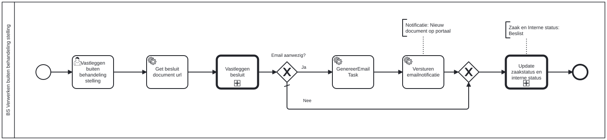

# BS Verwerken buiten behandeling stelling

Bouwblok `bs-verwerken-buiten-behandeling-stelling`.

## Invoer en uitvoer

Dit bouwblok benoemt geen invoer- en uitvoervariabelen in het procesmodel.

## Het procesmodel

Gegenereerd uit het BPMN-model. Open de afbeelding apart om in te zoomen.

## Het proces

| Soort | Stap |
| --- | --- |
| Gebruikerstaak | Vastleggen buiten behandeling stelling |
| Systeemstap | Get besluit document url |
| Aanroep | Vastleggen besluit → `generic-vastleggen-besluit` |
| Keuze | Email aanwezig? |
| Systeemstap | Versturen emailnotificatie |
| Aanroep | Update zaakstatus en interne status → `generic-update-zaakstatus-en-interne-status-plugin-v2` |
| Systeemstap | GenereerEmailTask |

## Onderdelen

**Formulieren**

* `bs.verwerken-buiten-behandeling-stelling-besluit.vastleggen-buiten-behandeling-stelling`

Dit bouwblok heeft een eigen documentdefinitie.

---

Terug naar [Business services](../business-services.md).
