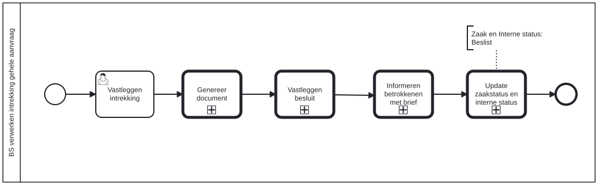

# BS verwerken intrekking gehele aanvraag

Bouwblok `bs-verwerken-intrekking`.

## Invoer en uitvoer

Dit bouwblok benoemt geen invoer- en uitvoervariabelen in het procesmodel.

## Het procesmodel

Gegenereerd uit het BPMN-model. Open de afbeelding apart om in te zoomen.

## Het proces

| Soort | Stap |
| --- | --- |
| Gebruikerstaak | Vastleggen intrekking |
| Aanroep | Genereer document → `alo-genereer-document` |
| Aanroep | Vastleggen besluit → `generic-vastleggen-besluit` |
| Aanroep | Informeren betrokkenen met brief → `generic-informeren-betrokkenen-met-brief` |
| Aanroep | Update zaakstatus en interne status → `generic-update-zaakstatus-en-interne-status-plugin-v2` |

## Onderdelen

**Formulieren**

* `bs.verwerken-intrekking.vastleggen-intrekking`

Dit bouwblok heeft een eigen documentdefinitie.

---

Terug naar [Business services](../business-services.md).
