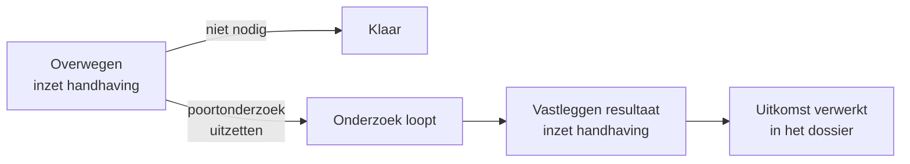
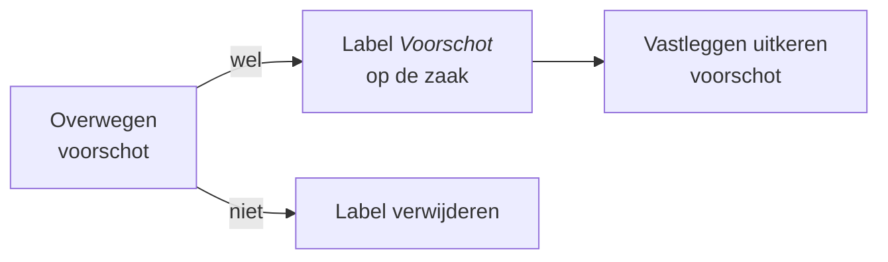

# Handhaving en voorschot

Twee business services lopen naast de gewone vaststellingen mee. Ze stellen geen feiten vast, maar geven de behandelaar ruimte om in te grijpen wanneer de situatie daarom vraagt.

## Handhaving: het poortonderzoek

Een **poortonderzoek** is onderzoek aan de voorkant van de aanvraag, wanneer er aanleiding is om de rechtmatigheid extra te toetsen — bijvoorbeeld bij tegenstrijdigheden tussen de aanvraag en de brongegevens, of bij een adres waar opvallend veel mensen staan ingeschreven.

### Overwegen

De service *Overwegen inzetten handhaving* start automatisch mee aan het begin van de vaststellingsfase. De behandelaar krijgt de vraag of er aanleiding is voor een poortonderzoek.

Zegt de behandelaar nee, dan is de service klaar. Zegt hij ja, dan volgt de gebeurtenis `handhaving-ingezet` en start de regie de vervolgservice.


De behandelaar kan de overweging later alsnog opnieuw starten. De regie annuleert dan zowel de lopende overweging als een eventuele resultaatvastlegging, en begint opnieuw.


### Resultaat vastleggen

Als het onderzoek is afgerond, legt de behandelaar de uitkomst vast via *Verwerken uitkomst poortonderzoek*. Het resultaat komt in het zaakdossier onder `poortonderzoek` en weegt mee in het uiteindelijke besluit.

### Signaal: adressen met veel bewoners

Mijn Inkomen heeft een hulpmiddel voor een veelvoorkomende aanleiding. Het proces `alo-controleren-adres-veel-bewoners` controleert het opgegeven adres tegen een beheerde lijst van **adressen met veel bewoners**, opgeslagen als objecttype in de Objects API.

Die lijst is via het datamenu in de applicatie te onderhouden — toevoegen en aanpassen kan zonder release. Daarnaast haalt het systeem via de Haal Centraal Bewoning-API op hoeveel personen er feitelijk op het adres staan ingeschreven.

### Dashboardsignalering

Op elk dashboard staat de teller *Poortonderzoek gestart, niet afgerond, afgelopen 4 weken*, zodat onderzoeken die blijven liggen zichtbaar worden.

## Voorschot

Een aanvraag beoordelen kost tijd. Om te voorkomen dat de inwoner ondertussen zonder inkomen zit, kan er een **voorschot** worden verstrekt.

### Hoe het werkt

De service *Overwegen voorschot* legt de behandelaar de vraag voor of een voorschot nodig is. Afhankelijk van het antwoord zet of verwijdert het systeem het label **Voorschot** op de zaak — zichtbaar in de zaaklijst, zodat in één oogopslag duidelijk is welke dossiers een lopend voorschot hebben.

Wordt er een voorschot toegekend, dan legt de behandelaar het via *Vastleggen uitkeren voorschot* vast. De gegevens komen in het zaakdossier onder `gegevensVaststelling.vastleggenVoorschot`; er kunnen meerdere voorschotten per zaak zijn.

### Wanneer start de overweging

Anders dan de handhavingsoverweging start de voorschotoverweging niet automatisch mee aan het begin van de vaststellingsfase. In het hoofdproces zit een apart subproces *starten overwegen voorschot* dat de overweging aanzwengelt; daarnaast kan de behandelaar hem op elk moment tijdens de vaststellingsfase zelf starten via de gebeurtenis `start-overwegen-voorschot`.


Een voorschot is een vooruitbetaling, geen besluit. Wordt de aanvraag uiteindelijk afgewezen, dan kan het voorschot teruggevorderd worden. Die terugvordering zelf valt buiten Mijn Inkomen en wordt in Socrates afgehandeld.


## Waar staat wat

| Onderdeel | Bestand |
| --- | --- |
| Overwegen handhaving | `bpmn/business-service/bs-overwegen-inzetten-handhaving.bpmn` |
| Resultaat handhaving | `bpmn/business-service/bs-vastleggen-resultaat-inzet-handhaving.bpmn` |
| Overwegen voorschot | `bpmn/business-service/bs-overwegen-voorschot.bpmn` |
| Adrescontrole | `bpmn/aanvraag-levensonderhoud/shared/alo-controleren-adres-veel-bewoners.bpmn` |
| Lijst adressen | Objecttype *Adressen met veel bewoners* |
