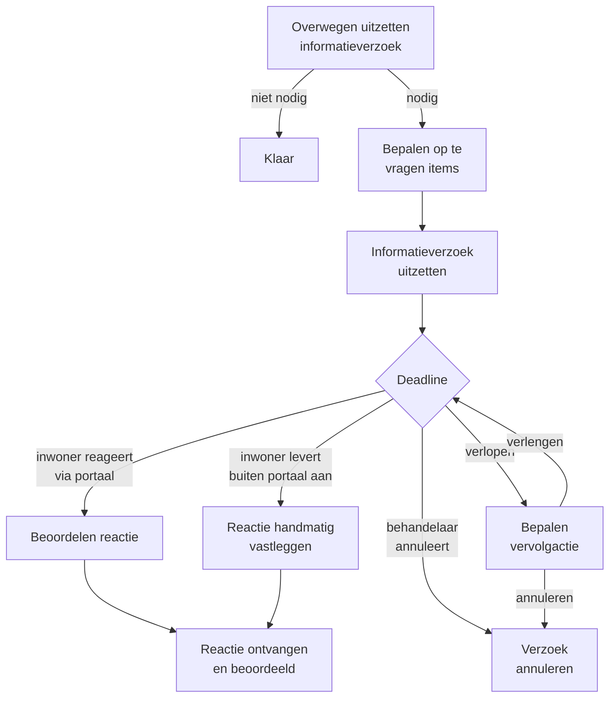

# Informatieverzoeken


Deze functionaliteit is geïntroduceerd in [Release Junin](../releasenotes/junin.md). Raadpleeg de releasenotes voor de meest recente wijzigingen.


Ontbreken er gegevens om de aanvraag te kunnen beoordelen, dan vraagt de behandelaar die op bij de inwoner. Dat heet een **informatieverzoek**. Het is een van de meest uitgewerkte onderdelen van Mijn Inkomen, omdat er veel bij komt kijken: een brief, een taak in het portaal, een deadline, een hersteltermijn die de beslistermijn opschort, en een beoordeling van wat er binnenkomt.

## Het verloop

## Stap voor stap

### 1. Overwegen

De business service *Overwegen uitzetten informatieverzoek* legt de behandelaar de vraag voor of er aanvullende gegevens nodig zijn. Luidt het antwoord nee, dan is de service klaar en gebeurt er verder niets.

Deze overweging kan meermaals terugkomen: na een afgerond verzoek kan de behandelaar besluiten een volgend verzoek uit te zetten.

### 2. Bepalen welke items worden opgevraagd

Zegt de behandelaar ja, dan volgt een scherm waarin hij aanvinkt wát er wordt opgevraagd. De keuzelijst komt niet uit het formulier zelf, maar uit een **objecttype in de Objects API**: *ALO: Informatieverzoek Items*.


Omdat de lijst in de Objects API staat, kan een functioneel beheerder items toevoegen of aanpassen zonder dat er een release nodig is. De lijst is beheerbaar via het datamenu in de applicatie.


Zijn de items bepaald, dan meldt de service de gebeurtenis `op-te-vragen-items-bepaald`. De regie start daarop de volgende service: *Uitzetten en opvolgen informatieverzoek*.

### 3. Uitzetten

Het uitzetten doet vier dingen tegelijk:

| Actie | Toelichting |
| --- | --- |
| **Brief genereren** | Een document met de opgevraagde items, gebaseerd op het FreeMarker-sjabloon `informatieverzoek.ftlh`. Het document wordt opgeslagen in de Documenten API en aan de zaak gekoppeld. |
| **Betrokkenen informeren** | De brief gaat naar de inwoner; daarnaast kan er een e-mailnotificatie uitgaan. |
| **Portaaltaak aanmaken** | In het klantportaal verschijnt de taak *Aanleveren informatie*, met de deadline erbij. |
| **Hersteltermijn starten** | Is een hersteltermijn van toepassing, dan wordt de einddatum van de beslistermijn opnieuw berekend. |

De interne status van de zaak gaat naar **Informatieverzoek uitgezet**.


**De hersteltermijn schort de beslistermijn op.** Zolang de inwoner aan zet is, telt die tijd niet mee voor de wettelijke afhandeltermijn. Bij elke mutatie — uitzetten, verlengen, annuleren, reactie ontvangen — wordt de einddatum van de beslistermijn opnieuw bepaald. Of de hersteltermijn van toepassing is, is per verzoek een keuze.


### 4. Wachten op reactie

Vanaf hier zijn er vier dingen die kunnen gebeuren. Ze lopen parallel; wat als eerste gebeurt, bepaalt het vervolg.



De inwoner rondt de taak in het portaal af en uploadt de gevraagde documenten. Mijn Inkomen haalt de bijbehorende zaakinformatieobjecten op en biedt de behandelaar de taak *Beoordelen resultaat informatieverzoek* aan.

De interne status gaat naar **Aanvullende informatie ontvangen**.



Levert de inwoner de stukken op een andere manier aan — per post, aan de balie — dan legt de behandelaar die handmatig vast via *Uploaden ontvangen documenten*. De openstaande portaaltaak wordt daarbij ingetrokken.

Het startproces hiervoor is `ab-start-reactie-informatieverzoek-dcm`.



Reageert de inwoner niet op tijd, dan krijgt de behandelaar de taak *Bepalen vervolgactie na verlopen deadline*. Daar zijn twee keuzes: de deadline verlengen, of het verzoek annuleren.

De interne status gaat naar **Geen aanvullende informatie ontvangen**.



De behandelaar kan zelf het verzoek annuleren (`ab-start-annuleren-informatieverzoek-dcm`) of de deadline verlengen (`ab-start-verlengen-deadline-informatieverzoek-dcm`), zonder de deadline af te wachten.



### 5. Beoordelen

De behandelaar beoordeelt of het aangeleverde voldoende is. De uitkomst bepaalt het vervolg: is alles compleet, dan kan de behandeling verder; zo niet, dan kan er een nieuw verzoek uitgaan of kan de aanvraag buiten behandeling worden gesteld.

## Deadline verlengen

Bij het verlengen voert de behandelaar een nieuwe deadline in. Het systeem:

1. beëindigt de bestaande einddatum van de beslistermijn;
2. berekent een nieuwe einddatum;
3. werkt de deadline op de portaaltaak bij, zodat de inwoner de nieuwe datum ziet.

## Annuleren

Bij het annuleren:

1. wordt de portaaltaak ingetrokken, waarna het systeem wacht tot die intrekking bevestigd is;
2. wordt de hersteltermijn verwijderd en de einddatum van de beslistermijn opnieuw bepaald;
3. gaat de interne status terug naar **In behandeling genomen**.

## Meerdere verzoeken

Er kunnen in de loop van een zaak meerdere informatieverzoeken uitgaan. Alle verzoeken worden bewaard in het zaakdossier onder `informatieverzoeken`, met hun items, deadline, status en de ontvangen documenten.

Het tabblad **Informatieverzoeken** in het zaakscherm toont de volledige historie. Op de dashboards staat een teller *Uitstaande informatieverzoeken*.

## Waar staat wat

De informatieverzoekprocessen zijn generiek opgezet, zodat ze voor beide regelingen werken:

| Proces | Bestand |
| --- | --- |
| Uitzetten | `bpmn/generic/informatieverzoek/generic-uitzetten-informatieverzoek.bpmn` |
| Beoordelen reactie | `…/generic-beoordelen-reactie-informatieverzoek.bpmn` |
| Reactie vastleggen | `…/generic-vastleggen-reactie-informatieverzoek.bpmn` |
| Deadline verlengen | `…/generic-verlengen-deadline-informatieverzoek.bpmn` |
| Verlopen deadline opvolgen | `…/generic-opvolgen-verlopen-deadline-informatieverzoek.bpmn` |
| Annuleren | `…/generic-annuleren-informatieverzoek.bpmn` |
| Portaaltaak + hersteltermijn opruimen | `…/generic-annuleren-portaaltaak-en-verwijderen-hersteltermijn.bpmn` |

De orkestratie eromheen zit in `bs-uitzetten-opvolgen-informatieverzoek.bpmn`.
