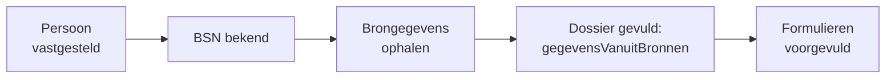
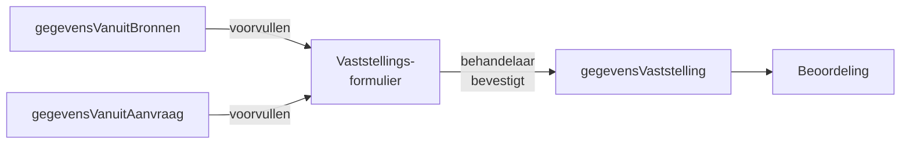

# Brongegevens

Een groot deel van wat nodig is om een aanvraag te beoordelen, staat al in landelijke registraties. Mijn Inkomen haalt die gegevens automatisch op, zodat de behandelaar vooral hoeft te toetsen in plaats van over te typen — en zodat de inwoner niet hoeft aan te leveren wat de overheid al weet.

## Wanneer wordt er opgehaald

Het ophalen gebeurt in de fase `opvoeren-dienst`, direct nadat de persoon is vastgesteld en het BSN dus vaststaat. Bij een aanvraag met partner gebeurt het twee keer, voor beiden apart.

Daarnaast kan de behandelaar de gegevens op elk moment tijdens de behandeling opnieuw ophalen met **Brongegevens verversen** (`ab-start-verversen-brongegevens`). De regie annuleert dan het lopende ophaalproces en start een verse ronde.

## Suwinet

Suwinet is het landelijke netwerk waarmee gemeenten gegevens opvragen bij andere uitvoeringsorganisaties. Mijn Inkomen raadpleegt zeven diensten.

| Bron | Wat het oplevert | Gebruikt bij |
| --- | --- | --- |
| **UWV** | Dienstverbanden, loongegevens, uitkeringen. | Vaststelling inkomen (BS 224) |
| **SVB** | AOW, Anw en andere SVB-uitkeringen. | Vaststelling inkomen (BS 224) |
| **DUO — opleiding** | Ingeschreven opleidingen. | Uitsluitingsgronden (BS 218) |
| **DUO — studiefinanciering** | Toegekende studiefinanciering. | Vaststelling inkomen, voorliggende voorzieningen (BS 444) |
| **RDW** | Voertuigen op naam. | Vaststelling vermogen (BS 214) |
| **Kadaster** | Onroerend goed op naam. | Vaststelling vermogen (BS 214) |
| **BRP** | Persoons- en adresgegevens, nationaliteit, relaties. | Persoon, verblijfadres, relaties |
| **Bijstandsregelingen** | Lopende of eerdere bijstandsregelingen elders. | Voorliggende voorzieningen (BS 444) |

Elke bevraging heeft een eigen generiek proces in `bpmn/generic/suwinet-brongegevens/`, zodat ze los van elkaar kunnen falen zonder de rest te blokkeren.


**Suwinet-gegevens zijn privacygevoelig.** De raadpleging is gebonden aan doelbinding: er mag alleen worden opgehaald wat nodig is voor déze aanvraag. Alle bevragingen worden gelogd; het tabblad *Audit* toont wat er is opgehaald en wanneer.


## Haal Centraal

| API | Wat het oplevert | Gebruikt bij |
| --- | --- | --- |
| **BRP Bewoning** | Wie er op een adres staan ingeschreven, en sinds wanneer. | Leef- en woonsituatie (BS 223), handhaving |
| **BAG** | Officiële adres- en pandgegevens. | Adresvalidatie |

De bewoningsbevraging is de basis voor het tabblad **Bewoning** en voor de signalering rond adressen met veel bewoners. Zie [Handhaving en voorschot](../functionaliteit/handhaving-en-voorschot.md).

## Wat er in het dossier landt

Alle opgehaalde gegevens komen onder `gegevensVanuitBronnen`:

| Veld | Inhoud |
| --- | --- |
| `aanvrager`, `partner` | Persoonsgegevens uit de BRP. |
| `inkomstenAanvrager`, `inkomstenPartner` | Inkomsten uit UWV-gegevens. |
| `svbUitkeringenAanvrager`, `svbUitkeringenPartner` | SVB-uitkeringen. |
| `vermogenAanvrager`, `vermogenPartner` | Vermogen uit Kadaster- en RDW-gegevens. |
| `duoAanvrager.opleiding`, `duoPartner.opleiding` | Opleidingsgegevens. |
| `duoStudiefinancieringAanvrager`, `duoStudiefinancieringPartner` | Studiefinanciering. |
| `bewoningen` | Bewoningsgegevens van het adres. |

Daarnaast houdt het dossier bij welke bronnen zijn geraadpleegd (`ophalenBronGegevens`) en of dat is gelukt.

## Als een bron niet antwoordt

Bronnen zijn niet altijd bereikbaar. Mijn Inkomen gaat daar bewust mee om:

* elke bevraging loopt in een **eigen proces**, zodat één storing de andere bevragingen niet raakt;
* er geldt een **time-out** van tien seconden per aanroep;
* fouten worden vastgelegd in `connectionError` in het dossier, met foutcode.


De behandeling loopt dóór als een bron uitvalt. De betreffende gegevens zijn dan niet voorgevuld en de behandelaar vult ze handmatig in — of hij ververst de brongegevens later alsnog.


## Van bron naar formulier

Opgehaalde gegevens worden niet automatisch waarheid. Ze vullen de vaststellingsformulieren voor, waarna de behandelaar bevestigt of corrigeert. Pas de vastgestelde waarde telt mee voor het besluit.

Op het tabblad **Suwinet** blijven de ruwe brongegevens zichtbaar, zodat de behandelaar altijd kan terugkijken wat de bron precies zei.

## Lokaal ontwikkelen

Voor lokale ontwikkeling draait er een **Suwinet-simulator** in plaats van het echte netwerk, en mocks voor BRP Bewoning en de BAG. Zie [Lokaal draaien](../beheer/lokaal-draaien.md).
