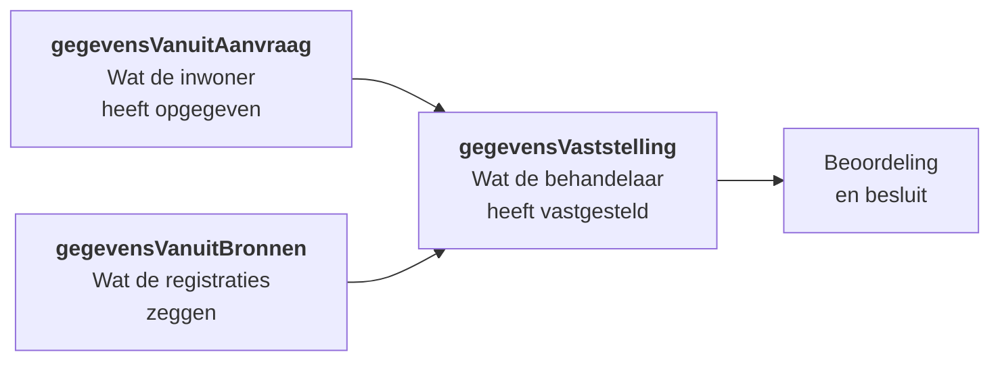

# Datamodel

Het zaakdossier is een JSON-document waarvan de structuur vastligt in een JSON Schema: `aanvraag-algemene-bijstand-dcm.schema.json` respectievelijk `aanvraag-ioaw-uitkering-dcm.schema.json`. Alles wat tijdens de behandeling gebeurt, landt in dit document.

## De hoofdstructuur

| Sectie | Inhoud |
| --- | --- |
| `verzoekGegevensTeTransformeren` | De ruwe aanvraag zoals die uit het portaal kwam, vóór bewerking. |
| `gegevensVanuitAanvraag` | De aanvraag, omgezet naar de dossierstructuur. |
| `gegevensVanuitBronnen` | Wat er bij de landelijke registraties is opgehaald. |
| `gegevensVaststelling` | Wat de behandelaar heeft vastgesteld. **Dit is de waarheid voor de beoordeling.** |
| `besluiten` | De genomen besluiten. |
| `informatieverzoeken` | Alle uitgezette informatieverzoeken. |
| `poortonderzoek` | De uitkomst van een eventueel handhavingsonderzoek. |
| `openzaak` | De koppeling met de zaak in Open Zaak. |
| `socrates` | Het aanvraag-ID in de uitkeringsadministratie. |
| `ophalenBronGegevens` | Administratie van welke bronnen zijn geraadpleegd. |
| `connectionError` | Fouten bij het raadplegen van bronnen. |
| `publicReference` | De publieke referentie van de zaak. |

## Drie keer dezelfde gegevens — met opzet

Het valt op dat `gegevensVanuitAanvraag`, `gegevensVanuitBronnen` en `gegevensVaststelling` elkaar grotendeels overlappen. Dat is geen duplicatie, maar het hart van het ontwerp.



Elke sectie heeft een eigen rol:



Wat de inwoner zelf heeft opgegeven. Deze sectie wordt **nooit meer gewijzigd** — het is de vastlegging van wat er is aangevraagd.

Blijkt later dat de inwoner iets verkeerd heeft ingevuld, dan corrigeert de behandelaar dat in de vaststelling, niet hier. Zo blijft achteraf aantoonbaar wat er oorspronkelijk is opgegeven.



Wat UWV, SVB, DUO, RDW, Kadaster en de BRP leveren. Ook deze sectie is een registratie: hij wordt overschreven bij het verversen van brongegevens, maar niet handmatig aangepast.

Zie [Brongegevens](bronnen.md).



Wat de behandelaar, alles afwegend, als juist vaststelt. Bij het invullen worden de formulieren voorgevuld met de aanvraag- en brongegevens, zodat de behandelaar vooral hoeft te bevestigen of te corrigeren.

**Dit is wat telt voor het besluit.** Alle beslistabellen en alle berekeningen kijken hiernaar.




Hierdoor is altijd terug te zien wáár een gegeven vandaan komt en of het is aangepast. Dat is nodig voor de motivering van het besluit en bij bezwaar.


## Wat er in de vaststelling staat

| Veld | Inhoud |
| --- | --- |
| `startDatum`, `meldingsDatum` | Datum van melding en start van de aanvraag. |
| `aanvrager`, `partner` | Persoonsgegevens. |
| `kinderen`, `medebewoners` | Huishoudsamenstelling. |
| `medebewonersOpAdres` | Aantal medebewoners, bepalend voor de kostendelersnorm. |
| `contactpersoon` | Een eventuele contactpersoon. |
| `heeftHulpGehadBijAanvraag` | Of de aanvrager hulp heeft gehad bij het indienen. |
| `woonsituatie`, `leefsituatie` | Woonvorm en leefsituatie. |
| `redenAanvraag` | Waarom de aanvraag wordt gedaan. |
| `inkomstenAanvrager`, `inkomstenPartner` | Vastgestelde inkomsten. |
| `kinderAlimentatieAanvrager`, `partnerAlimentatieAanvrager`, `partnerAlimentatie` | Alimentatiestromen. |
| `vermogen` | Vastgesteld vermogen. |
| `beschikbaarheidAanvrager`, `beschikbaarheidPartner` | Beschikbaarheid voor de arbeidsmarkt. |
| `uitbetaling` | Waar en hoe de uitkering wordt betaald. |
| `vastleggenVoorschot` | Toegekende voorschotten. |
| `uitzettenInformatieverzoek`, `informatieverzoekAfgerond` | Stand van het informatieverzoek. |
| `additioneleVeldenAanvrager`, `additioneleVeldenPartner`, `additioneleVeldenAanvraag` | Ruimte voor velden die bij specifieke vaststellingen horen, zoals de normberekening. |

## Het besluit

```json
{
  "genomenBesluit": "TOEGEKEND | AFGEWEZEN | INGETROKKEN | BUITEN_BEHANDELING_GESTELD",
  "versneldBeslist": true,
  "beslisser": "…",
  "besluitDatum": "…",
  "redenAfwijzing": "…",
  "vervalreden": "…"
}
```

Omdat `besluiten` een lijst is, kunnen er meerdere besluiten in één zaak zitten — bijvoorbeeld wanneer de behandeling opnieuw is gestart nadat er al beslist was.

## Herbruikbare schema's

Het dossierschema definieert weinig zelf. Het verwijst naar een bibliotheek van losse schema's, zodat begrippen als *persoon* of *adres* overal dezelfde structuur hebben.

### Structuurdefinities

In `document/definition/reference/sd/` staan ruim veertig schema's voor de concrete gegevensstructuren: persoon, partner, kind, medebewoner, adres, woonsituatie, inkomsten, vermogen, loondienst, onderneming, alimentatie, opleiding, studiefinanciering, kadastraal object, bewoning, contactpersoon, uitbetaling, en meer.


**Let op de versienummers.** Veel schema's bestaan in meerdere versies naast elkaar: `persoon-sd-v1` en `v2`, `vermogen-sd-v1` tot en met `v5`, `inkomsten-sd-v1` tot en met `v3`.

Dat is bewust. Lopende zaken blijven op het schema waarmee ze zijn gestart; nieuwe zaken gebruiken de nieuwste versie. Het dossierschema verwijst momenteel naar `persoon-sd-v2`, `vermogen-sd-v4` en `inkomsten-sd-v3`. Oudere versies blijven bestaan zolang er zaken op draaien.


### Ontologieschema's

In `document/definition/reference/ontologie/` staat een tweede laag: schema's die het *domein* beschrijven in plaats van de opslagstructuur. Ze volgen de landelijke ontologie voor inkomensvoorzieningen — onder meer persoonsgegevens, relaties, inkomen, vermogen, levenssituatie, locatie, diensten, regels, normafwijking, terug- en invordering, compliance en proces.

Deze laag maakt het mogelijk om de implementatie te spiegelen aan het landelijke begrippenkader.

### Algemene referenties

| Schema | Gebruik |
| --- | --- |
| `openzaak.schema.json` | De koppeling met de zaak: identificatie, status, resultaat. |
| `adres.schema.json` | Adresgegevens. |
| `contactgegevens.schema.json` | Telefoon, e-mail. |
| `persoonsgegevens.schema.json` | Basispersoonsgegevens. |
| `documenten-api-file.schema.json` | Verwijzing naar een document in de Documenten API. |
| `formio-file.schema.json`, `valtimo-file.schema.json` | Geüploade bestanden. |

## Van portaal naar dossier: value mapping

De aanvraag uit het portaal heeft niet dezelfde structuur als het dossier. Bij initialisatie komt de ruwe aanvraag eerst in `verzoekGegevensTeTransformeren` terecht, waarna een **value mapping** hem omzet naar `gegevensVanuitAanvraag`.

Die mappings staan in `config/valuemapping/` en zijn geversioneerd: `aanvraag-levensonderhoud-v2` en `-v3`. Verandert het aanvraagformulier in het portaal, dan volstaat een nieuwe mapping — het dossierschema hoeft niet mee.

De verzoekplugin bepaalt welke onderdelen van het portaalverzoek worden overgenomen: persoonsgegevens, aanvullende gegevens, gezinssamenstelling, partnergegevens, kindgegevens en meer.
