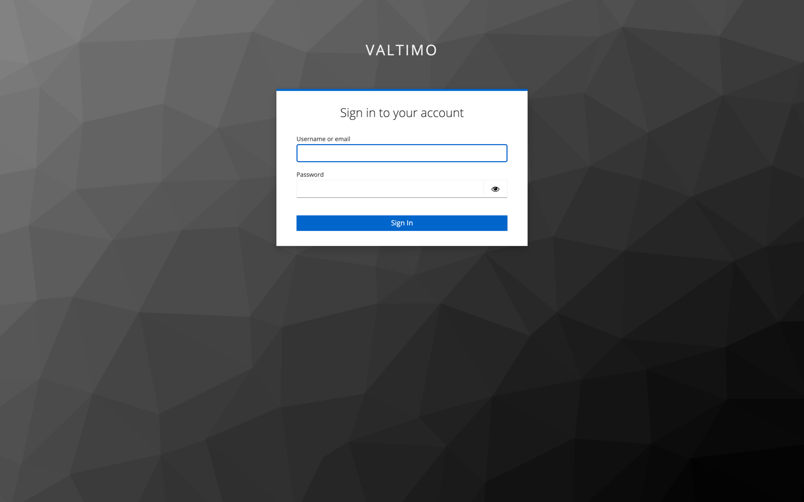
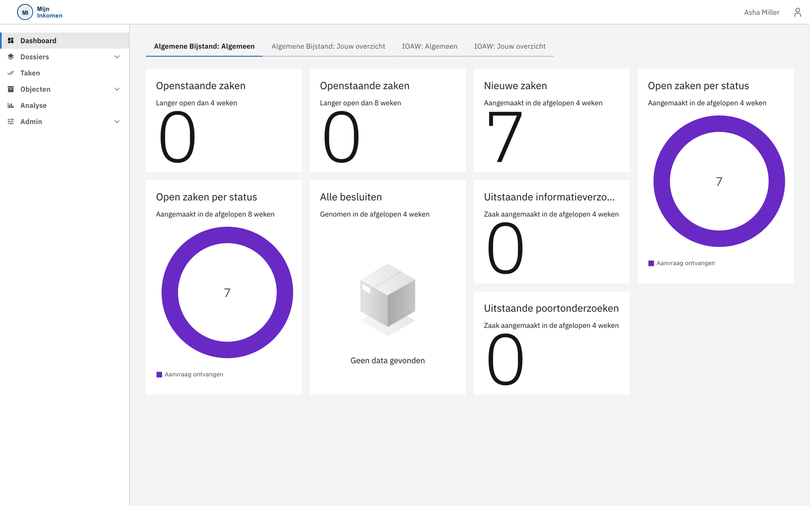
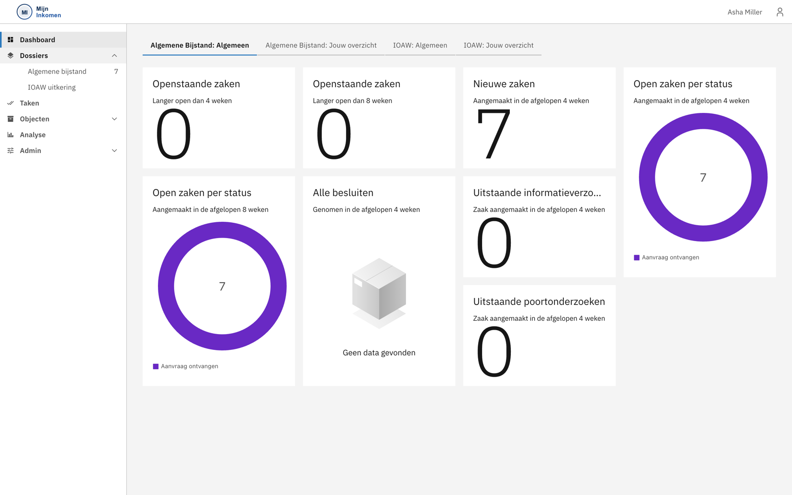
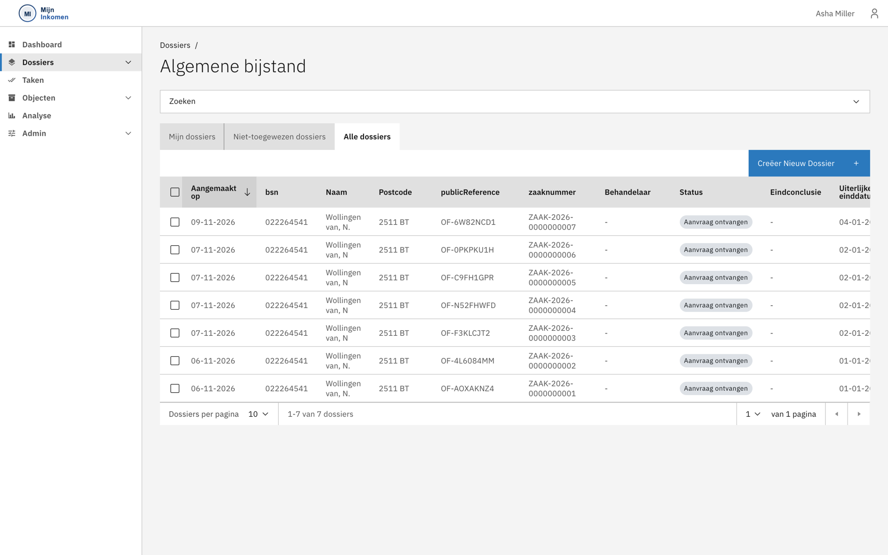
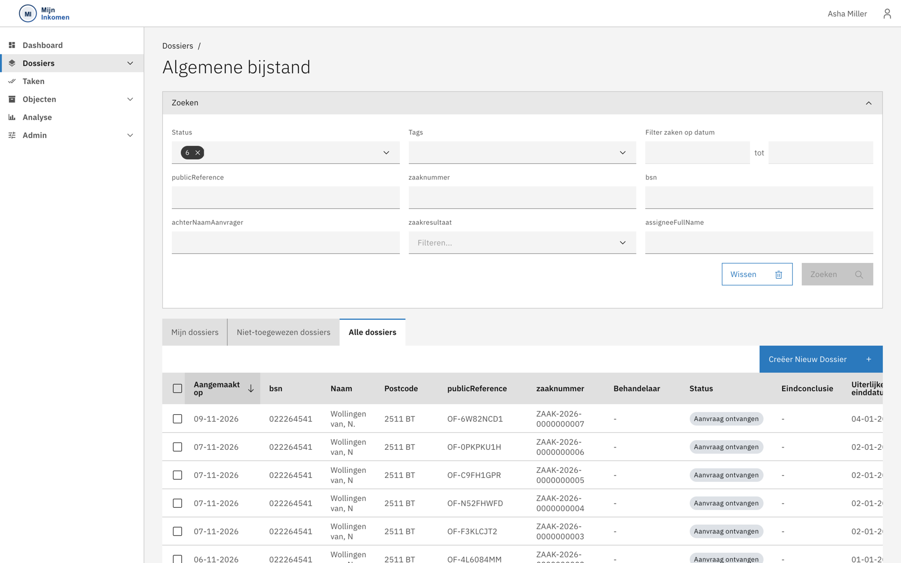

# Aan de slag

Deze handleiding laat zien hoe je met Mijn Inkomen werkt. De schermafbeeldingen komen uit een testomgeving met fictieve dossiers.


De getoonde gegevens zijn **dummygegevens** uit een testomgeving. Namen, BSN's en adressen in deze handleiding verwijzen niet naar bestaande personen.


## Inloggen

Mijn Inkomen gebruikt de gemeentelijke inlogvoorziening. Je komt binnen op een inlogscherm waar je je gebruikersnaam en wachtwoord invult.

Welke schermen je na het inloggen ziet, hangt af van je rol. Mis je een tabblad of knop die in deze handleiding staat, dan heeft je rol dat recht niet — zie [Rollen en rechten](../functionaliteit/rollen-en-rechten.md).

## Het dashboard

Na het inloggen kom je op het dashboard. Dat geeft in één oogopslag de stand van het werk.

Bovenaan staan vier tabbladen: per regeling een **algemeen** overzicht van alle zaken, en een **jouw overzicht** met alleen de zaken die aan jou zijn toegewezen.

De widgets eronder signaleren waar aandacht nodig is:

| Widget | Wat het je vertelt |
| --- | --- |
| Openstaande zaken, langer dan 4 weken | Dossiers die beginnen te lopen. |
| Openstaande zaken, langer dan 8 weken | Dossiers die te lang liggen. |
| Nieuwe zaken | De instroom van de afgelopen 4 weken. |
| Open zaken per status | Waar de werkvoorraad zich ophoopt. |
| Alle besluiten | De uitstroom. |
| Uitstaande informatieverzoeken | Hoeveel dossiers op de inwoner wachten. |
| Uitstaande poortonderzoeken | Onderzoeken die nog niet zijn afgerond. |

Je kunt vanuit een widget doorklikken naar de onderliggende zaken.

## Het menu

Links staat het hoofdmenu. **Dossiers** klapt open naar de regelingen waarvoor je geautoriseerd bent.

| Menu-item | Waarvoor |
| --- | --- |
| Dashboard | De stuurinformatie hierboven. |
| Dossiers | De zaaklijsten per regeling. |
| Taken | Alle taken die aan jou of je rol zijn toebedeeld. |
| Objecten | Beheerde lijsten, zoals de informatieverzoek-items. |
| Analyse | Rapportages. |
| Admin | Beheerfuncties. |

Achter **Dossiers** staat een teller met het aantal zaken dat op je wacht.

## De zaaklijst

Klik je op een regeling, dan open je de zaaklijst. Standaard sta je op **Mijn dossiers**: de zaken die aan jou zijn toegewezen.

Drie tabbladen bepalen welke zaken je ziet:

| Tabblad | Inhoud |
| --- | --- |
| **Mijn dossiers** | Zaken die aan jou zijn toegewezen. Je eigen werkvoorraad. |
| **Niet-toegewezen dossiers** | Zaken zonder behandelaar — hier pak je nieuw werk op. |
| **Alle dossiers** | Alles waar je rol toegang toe heeft. |

De kolommen tonen per zaak de aanmaakdatum, het BSN, de naam, de postcode, het referentienummer uit het aanvraagformulier, het zaaknummer, de behandelaar, de status, de eindconclusie en de uiterste einddatum.

De lijst is standaard gesorteerd op aanmaakdatum, nieuwste eerst. Klik op een kolomkop om anders te sorteren. Onderaan stel je in hoeveel dossiers je per pagina ziet.

### Zoeken en filteren

Boven de lijst zit een uitklapbare **Zoeken**-balk.

Je kunt filteren op datumbereik, referentienummer, zaaknummer, BSN, achternaam van de aanvrager, zaakresultaat en behandelaar. Op de meeste velden werkt een gedeeltelijke invoer — een deel van een achternaam volstaat.

### Een zaak openen

Klik op een rij om het dossier te openen. Vanaf daar werk je verder in het zaakscherm: zie [Werken met een dossier](werken-met-een-dossier.md).


De knop **Creëer Nieuw Dossier** rechtsboven maakt handmatig een zaak aan, zonder dat er een aanvraag via het portaal is binnengekomen. Dat gebruik je voor een aanvraag die op een andere manier is ingediend — en in een testomgeving om zelf een dossier op te voeren.

