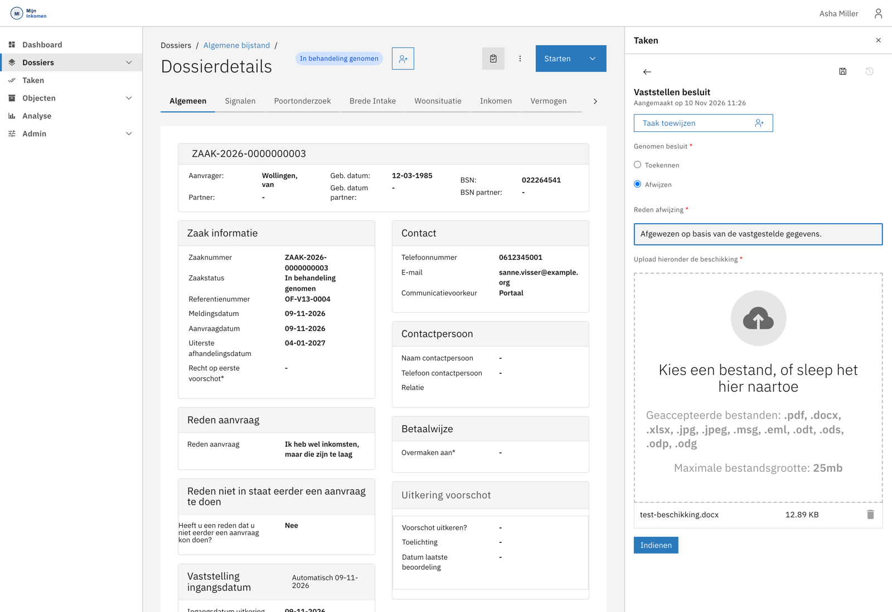

# Het besluit vastleggen

Zijn alle beoordelingen afgerond, dan biedt het systeem de taak **Vaststellen besluit** aan. Je kunt er ook eerder bij komen met *Aanvraag direct beslissen*.

Zie [Besluit en afsluiting](../functionaliteit/besluit-en-afsluiting.md) voor wat er achter de schermen gebeurt.

## Eerder beslissen dan het systeem voorstelt

Wil je niet wachten tot alle vaststellingen rond zijn, kies dan **Starten → Aanvraag direct beslissen**. Je krijgt een waarschuwing te zien en bevestigt met **Doorgaan**.


**Dit annuleert alle lopende beoordelingen.** Vaststellingen van vermogen, inkomen, relaties en de rest worden afgebroken; alleen het besluit blijft over. Gebruik het bewust.

De zaak blijft daarna nog zes weken in de bezwaartermijn staan voordat hij sluit.


Twee voorwaarden moeten vervuld zijn, anders weigert het systeem de actie met een uitleg in beeld:

| Voorwaarde | Wat je moet doen |
| --- | --- |
| Er staat geen informatieverzoek open | Annuleer het lopende verzoek via **Starten → Informatieverzoek annuleren**, of wacht de reactie af. |
| De uitgebreide motivering is definitief ingediend | Rond de taak *Opbouwen uitgebreide motivering* af en vink **Definitief indienen motivering** aan. |

## Het besluit kiezen

Bij **Genomen besluit** kies je tussen **Toekennen** en **Afwijzen**. Wat je daarna invult, hangt van die keuze af.



Er verschijnt een keuze voor de **bijstandsvorm** — bijvoorbeeld een lening, een krediethypotheek of een uitkering om niet. Per vorm vraagt het formulier om de bijbehorende gegevens.



Er verschijnen twee verplichte velden:

* **Reden afwijzing** — de onderbouwing van de afwijzing.
* **Upload hieronder de beschikking** — het besluitdocument zelf.

De upload accepteert `.pdf`, `.docx`, `.xlsx`, `.jpg`, `.jpeg`, `.msg`, `.eml`, `.odt`, `.ods`, `.odp` en `.odg`, tot 25 MB.



De knop **Indienen** wordt pas actief als alles is ingevuld, inclusief de geüploade beschikking.

## Daarna

Met het indienen gaat de zaak naar interne status **Beslist**. Er staan dan geen taken meer open: het systeem genereert de besluitbrief, registreert het besluit, en informeert de aanvrager als er een e-mailadres bekend is.


**De zaak verdwijnt daarmee uit je werkvoorraad.** De statussen *Beslist* en *Afgehandeld* staan standaard niet in de zaaklijst — die toont wat nog loopt. Wil je een beslist dossier terugvinden, pas dan het statusfilter aan of zoek op zaaknummer.


De zaak blijft open zolang de bezwaartermijn loopt. Verloopt die, dan sluit het systeem de zaak en gaat de status naar **Afgehandeld**.


**Ook een beslist dossier kan terug naar behandeling.** Zolang de zaak niet is afgesloten, kun je via **Starten → Behandeling aanvraag opnieuw starten** alles terugzetten naar de vaststellingsfase. Zie [Besluit en afsluiting](../functionaliteit/besluit-en-afsluiting.md).

