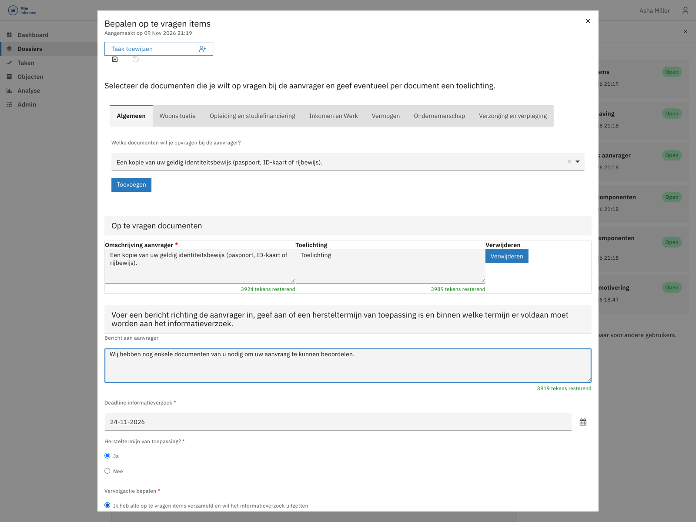
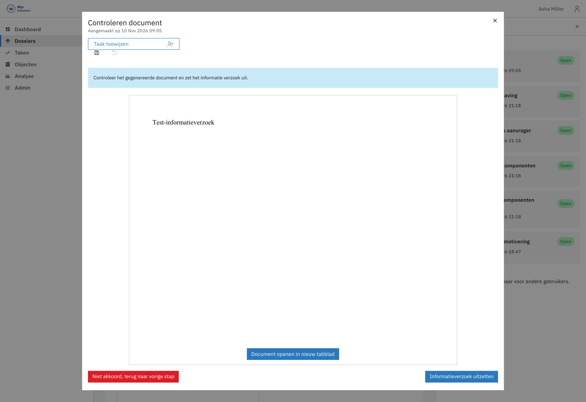
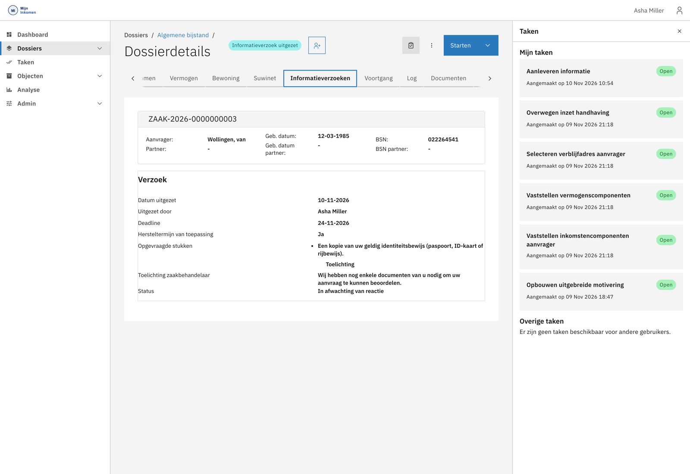

# Een informatieverzoek uitzetten

Mis je gegevens om de aanvraag te kunnen beoordelen, dan vraag je die op bij de inwoner. Dat gaat in drie stappen: eerst de afweging, dan het samenstellen van het verzoek, en ten slotte het controleren van de brief voordat die de deur uit gaat.

Zie [Informatieverzoeken](../functionaliteit/informatieverzoek.md) voor het volledige verloop inclusief deadlines, verlengen en annuleren.

## Stap 1 — Overwegen

In de vaststellingsfase staat de taak **Overwegen uitzetten informatieverzoek** open. Die stelt één vraag: is er aanvullende informatie nodig?

* Antwoord je **Nee**, dan is deze beoordeling klaar en gebeurt er verder niets.
* Antwoord je **Ja**, dan verschijnt direct de vervolgtaak **Bepalen op te vragen items**.


Je kunt deze afweging later opnieuw maken. Is een eerste verzoek afgerond en blijkt er alsnog iets te ontbreken, dan start je de overweging opnieuw en gaat er een tweede verzoek uit.


## Stap 2 — Het verzoek samenstellen

Deze taak opent in een venster over het dossier heen.

### De documenten kiezen

De op te vragen documenten zijn gegroepeerd in categorieën, als tabbladen bovenin:

| Categorie | Waarvoor |
| --- | --- |
| **Algemeen** | Identiteitsbewijs, verblijfsdocumenten en overige algemene stukken. |
| **Woonsituatie** | Huurovereenkomst, bewijs van inschrijving, woonlasten. |
| **Opleiding en studiefinanciering** | Inschrijfbewijs, beschikking studiefinanciering. |
| **Inkomen en Werk** | Loonstroken, arbeidsovereenkomst, uitkeringsbeschikkingen. |
| **Vermogen** | Bankafschriften, overzichten van bezittingen en schulden. |
| **Ondernemerschap** | Stukken over een eigen onderneming. |
| **Verzorging en verpleging** | Stukken rond zorg en verpleging. |

Kies per categorie een document uit de keuzelijst en klik op **Toevoegen**. Het gekozen document verschijnt dan onder **Op te vragen documenten**. Je kunt er zoveel toevoegen als nodig, uit verschillende categorieën.


**Je moet minimaal één document toevoegen.** Doe je dat niet, dan verschijnt de melding *"Kies minimaal één bestand uit een van de onderstaande categorieën en klik op de knop Toevoegen"* en kun je het verzoek niet indienen. Een document kiezen in de lijst is niet genoeg — je moet ook op **Toevoegen** klikken.


### Het bericht en de termijn

Onder de documentenlijst leg je vast wat de inwoner te horen krijgt:

| Veld | Toelichting |
| --- | --- |
| **Bericht aan aanvrager** | De tekst die in de brief en in het portaal verschijnt. Schrijf hier waarom je de stukken nodig hebt. |
| **Deadline informatieverzoek** | Tot wanneer de inwoner de tijd heeft. Voorgevuld met een standaardtermijn; aanpasbaar. |
| **Hersteltermijn van toepassing?** | Bepaalt of de wettelijke beslistermijn wordt opgeschort zolang de inwoner aan zet is. |
| **Vervolgactie bepalen** | Wat er na deze stap gebeurt. |


**De hersteltermijn is geen formaliteit.** Zet je hem op *Ja*, dan telt de tijd dat de inwoner aan zet is niet mee voor de wettelijke afhandeltermijn. Zet je hem op *Nee*, dan loopt die termijn gewoon door en komt de zaak sneller in de knel. Zie [Informatieverzoeken](../functionaliteit/informatieverzoek.md).


Bij **Vervolgactie bepalen** kies je uit drie opties:

* **Ik heb alle op te vragen items verzameld en wil het informatieverzoek uitzetten** — door naar de brief.
* **Ik wil het uitzetten van een informatieverzoek annuleren** — je ziet er toch van af; er gaat niets uit.
* **Ik ben nog niet klaar met het verzamelen van op te vragen items** — je bewaart je werk en pakt het later op.

Sluit af met **Brief genereren**. Het verzoek gaat daarmee nog niet de deur uit.

## Stap 3 — De brief controleren

Het systeem maakt de brief op en biedt hem aan ter controle, als taak **Controleren document**.

Je hebt twee keuzes:

* **Informatieverzoek uitzetten** — de brief klopt. Het verzoek gaat naar de inwoner en verschijnt als taak in het portaal.
* **Niet akkoord, terug naar vorige stap** — je gaat terug om de items of de tekst aan te passen.


Deze tussenstap is er met opzet: je ziet de daadwerkelijke brief voordat hij verstuurd wordt. Pas na *Informatieverzoek uitzetten* ontvangt de inwoner iets.


## Daarna

Is het verzoek uitgezet, dan gaat de zaak naar interne status **Informatieverzoek uitgezet** en verschijnt de taak *Aanleveren informatie* bij de inwoner in het portaal. Het systeem wacht.

Op het tabblad **Informatieverzoeken** zie je per verzoek de datum, wie het heeft uitgezet, de deadline, of er een hersteltermijn geldt, welke stukken zijn opgevraagd en de meegestuurde toelichting. Wat er daarna kan gebeuren — reactie via het portaal, handmatige aanlevering, verlopen deadline, of annuleren — staat in [Informatieverzoeken](../functionaliteit/informatieverzoek.md).

