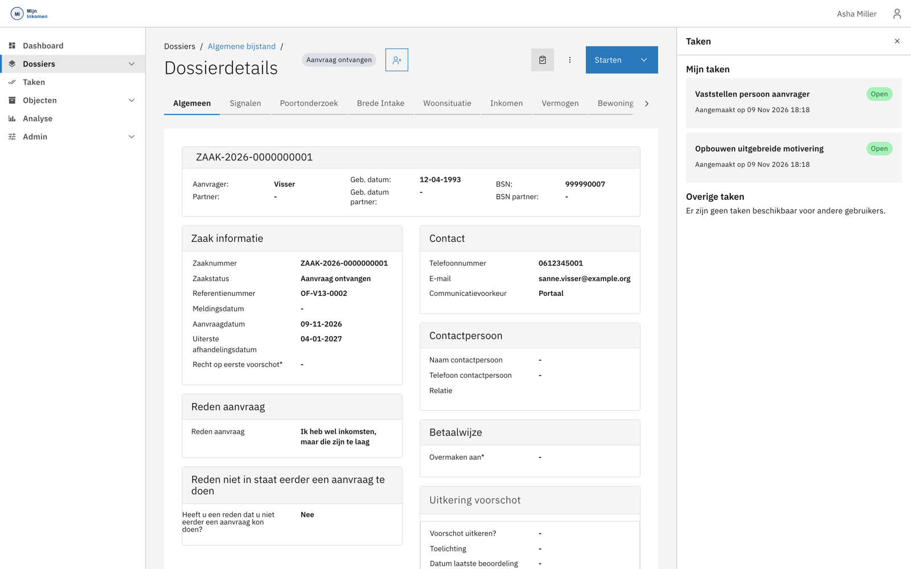
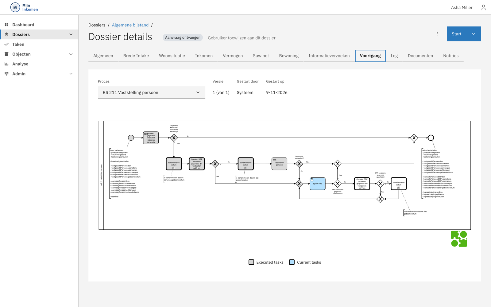
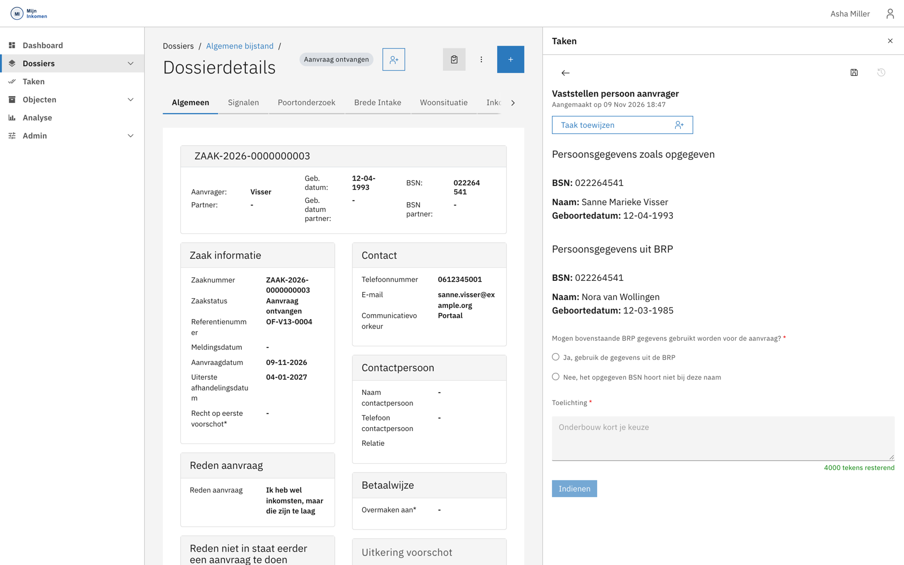
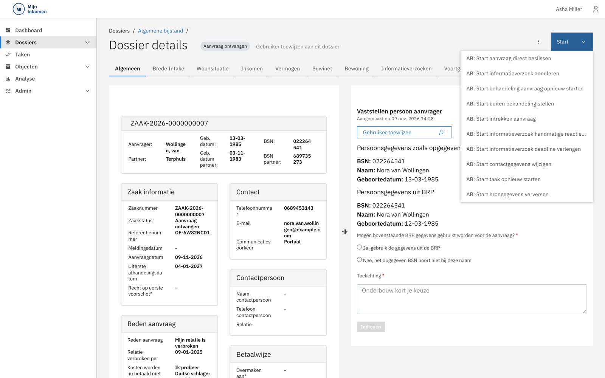

# Werken met een dossier

## Het zaakscherm

Open je een zaak, dan kom je op **Dossierdetails**. Dit scherm is je werkplek voor de hele behandeling.

Bovenaan staat altijd dezelfde kopbalk, ongeacht welk tabblad je bekijkt:

* het **zaaknummer**;
* de **interne status** — hier *Aanvraag ontvangen*;
* een knop om een **behandelaar aan het dossier** te koppelen;
* de knop **Starten** voor losse acties.

Daaronder staat een blok met de kerngegevens van aanvrager en partner: naam, geboortedatum en BSN. Dat blok blijft staan terwijl je door de tabbladen loopt, zodat je altijd weet over wie het gaat.

### Het tabblad Algemeen

Het eerste tabblad vat de zaak samen in blokken:

| Blok | Inhoud |
| --- | --- |
| Zaak informatie | Zaaknummer, status, referentienummer, meldings- en aanvraagdatum, uiterste afhandelingsdatum. |
| Reden aanvraag | Waarom de aanvraag is gedaan en hoe de kosten nu worden betaald. |
| Contact | Telefoonnummer, e-mailadres en communicatievoorkeur. |
| Contactpersoon | Een eventuele gemachtigde. |
| Betaalwijze | Waar de uitkering naartoe moet. |
| Uitkering voorschot | Toegekende voorschotten. |

Let op de **uiterste afhandelingsdatum**: dat is de wettelijke termijn waarbinnen beslist moet zijn. Loopt die af, dan krijgt de zaak automatisch een label.

## De tabbladen

Het dossier is verdeeld over veertien tabbladen.

| Tabblad | Wat je er doet |
| --- | --- |
| **Algemeen** | De samenvatting hierboven. |
| **Signalen** | Termijnsignalen en aandachtspunten bij deze zaak. |
| **Poortonderzoek** | Uitkomsten van het handhavingsonderzoek. |
| **Brede Intake** | Gegevens uit het intakegesprek. |
| **Woonsituatie** | Waar en met wie de aanvrager woont. |
| **Inkomen** | Inkomsten van aanvrager en partner. |
| **Vermogen** | Bankrekeningen, bezittingen, schulden, eigen woning. |
| **Bewoning** | Wie er volgens de BRP op het adres staan ingeschreven. |
| **Suwinet** | De ruwe brongegevens van UWV, SVB, DUO, RDW en Kadaster. |
| **Informatieverzoeken** | Alle verzoeken aan de inwoner, met status en ontvangen stukken. |
| **Voortgang** | Het procesverloop, als diagram. |
| **Log** | Het volledige wijzigingslogboek. |
| **Documenten** | Alle documenten bij de zaak. |
| **Notities** | Aantekeningen van behandelaars. |

Niet alle veertien passen tegelijk in beeld; met het pijltje rechts blader je verder.


Welke tabbladen je ziet, hangt af van je rol. *Suwinet* en *Bewoning* zijn bijvoorbeeld voorbehouden aan rollen die het dossier inhoudelijk beoordelen. Zie [Rollen en rechten](../functionaliteit/rollen-en-rechten.md).


### Voortgang: zien waar de zaak staat

Het tabblad **Voortgang** toont het procesmodel met de stand van zaken erin getekend.

Grijs omlijnde stappen zijn **uitgevoerd**, blauw gearceerde stappen zijn **op dit moment actief**. Met de keuzelijst linksboven wissel je tussen de processen die voor deze zaak lopen — hier *BS 211 Vaststelling persoon*.

Dit is het snelste antwoord op de vraag *"waarom gebeurt er niets?"*: je ziet direct op welke stap de zaak wacht.

## Taken uitvoeren

Rechts schuift het paneel **Taken** uit, verdeeld in *Mijn taken* en *Overige taken*. Klik op een taak om hem te openen; met het kruisje rechtsboven klap je het paneel weg.

De taak opent in een paneel náást het dossier, zodat je de zaakgegevens kunt blijven raadplegen terwijl je de taak invult.

### Hoe een vaststelling werkt

Dit patroon komt in bijna alle vaststellingstaken terug: het formulier zet **wat de inwoner heeft opgegeven** naast **wat de basisregistratie zegt**, en vraagt jou om de knoop door te hakken.

In het voorbeeld hierboven lopen beide uiteen:

| | Opgegeven | Volgens de BRP |
| --- | --- | --- |
| BSN | 022264541 | 022264541 |
| Naam | Sanne Marieke Visser | Nora van Wollingen |
| Geboortedatum | 12-04-1993 | 12-03-1985 |

Het BSN komt overeen, maar naam en geboortedatum niet. Precies daarvoor is deze taak er — het systeem kan zo'n verschil niet zelf wegstrepen.

Zulke verschillen hebben uiteenlopende oorzaken: een typefout bij het invullen, een recente naamswijziging die nog niet is verwerkt, of een BSN dat bij iemand anders hoort.

Je kiest tussen twee antwoorden:

* **Ja, gebruik de gegevens uit de BRP** — de basisregistratie is leidend; de aanvraaggegevens worden gecorrigeerd.
* **Nee, het opgegeven BSN hoort niet bij deze naam** — er is iets anders aan de hand, bijvoorbeeld een typefout in het BSN.

In beide gevallen onderbouw je je keuze in het veld **Toelichting**. Dat is verplicht, en het is wat later bij bezwaar je motivering vormt.


Wat je hier vaststelt, is wat meetelt voor de beoordeling. De oorspronkelijke aanvraaggegevens en de brongegevens blijven apart bewaard, zodat achteraf aantoonbaar is wat de inwoner opgaf, wat de bron zei en wat jij daarvan hebt gemaakt. Zie [Datamodel](../gegevens/datamodel.md).


Lukt de BRP-bevraging niet, dan blijven de BRP-velden leeg en meldt het formulier dat de gegevens niet konden worden opgehaald. Je krijgt dan een veld **Gewenst BSN** om een correctie door te geven, waarna de taak opnieuw wordt aangeboden.

Velden met een rood sterretje zijn verplicht. De knop **Indienen** wordt pas actief als alles is ingevuld én de taak aan jou is toegewezen.

Met de knoppen rechtsboven in het taakpaneel kun je tussentijds **opslaan**, de **geschiedenis** bekijken of de taak **sluiten** zonder in te dienen. Een taak die je sluit blijft openstaan.

### Een taak aan jezelf toewijzen

Boven in het taakpaneel staat **Taak toewijzen**. Daarmee claim je de taak, zodat voor collega's zichtbaar is dat jij ermee bezig bent.


**Je moet de taak eerst toewijzen voordat je hem kunt indienen.** Zolang de taak niet aan jou is toegewezen, blijft de knop **Indienen** grijs — ook als het formulier volledig is ingevuld. Dat is de meest voorkomende reden dat indienen niet lijkt te werken.


### Meerdere taken tegelijk

Verderop in de behandeling staan er vaak meerdere taken tegelijk open. Dat is geen achterstand, maar het ontwerp: de beoordelingen lopen parallel. Je kunt ze in willekeurige volgorde oppakken. Pas als ze allemaal zijn afgerond, schuift de zaak door naar de beslisfase.

Een **overweging** is een bijzonder soort taak: een enkele ja/nee-vraag die bepaalt of er vervolgwerk komt. Antwoord je bij *Overwegen uitzetten informatieverzoek* met **Ja**, dan verschijnt een vervolgtaak waarin je bepaalt welke stukken je opvraagt. Antwoord je **Nee**, dan is die beoordeling klaar.

## Als er iets misgaat

Sommige stappen praten met een extern systeem. Lukt dat niet, dan blijft de zaak staan en krijg je een taak met de foutmelding erbij — bijvoorbeeld wanneer de uitkeringsadministratie onbereikbaar is.

Je ziet dan wat er is misgegaan, en hebt twee knoppen:

* **Probeer het opnieuw** — gebruik dit als het probleem inmiddels verholpen is.
* **Overslaan** — hiermee gaat de behandeling verder zonder dat de stap is uitgevoerd.


**Overslaan lost het onderliggende probleem niet op.** De overgeslagen handeling is niet uitgevoerd; de zaak loopt wel door. Gebruik het bewust, en zorg dat het alsnog gebeurt.


## Losse acties starten

Niet al het werk komt als taak binnen. Soms moet je zelf iets in gang zetten — een informatieverzoek annuleren, de aanvraag intrekken, brongegevens opnieuw ophalen. Dat doe je met de knop **Starten** rechtsboven.

| Actie | Wanneer je die gebruikt |
| --- | --- |
| Aanvraag direct beslissen | Je wilt beslissen zonder alle vaststellingen af te wachten. |
| Informatieverzoek annuleren | Een uitstaand verzoek is niet meer nodig. |
| Behandeling aanvraag opnieuw starten | Het dossier moet helemaal terug naar de vaststellingsfase. |
| Buiten behandeling stellen | De inwoner levert gevraagde gegevens niet aan. |
| Intrekken aanvraag | De inwoner trekt de aanvraag in. |
| Informatieverzoek handmatige reactie | De inwoner levert stukken buiten het portaal om aan. |
| Informatieverzoek deadline verlengen | De inwoner krijgt meer tijd. |
| Contactgegevens wijzigen | Telefoonnummer of e-mailadres is veranderd. |
| Taak opnieuw starten | Een afgeronde taak moet over. |
| Brongegevens verversen | Opnieuw ophalen bij de landelijke registraties. |


Een paar van deze acties grijpen diep in. *Behandeling aanvraag opnieuw starten* annuleert alle lopende werkzaamheden in het dossier en zet de zaak terug naar de vaststellingsfase. *Intrekken* en *Buiten behandeling stellen* sluiten de inhoudelijke beoordeling af. Gebruik ze bewust.


Welke acties je in dit menu ziet, hangt opnieuw af van je rol en van de fase waarin de zaak zich bevindt.
