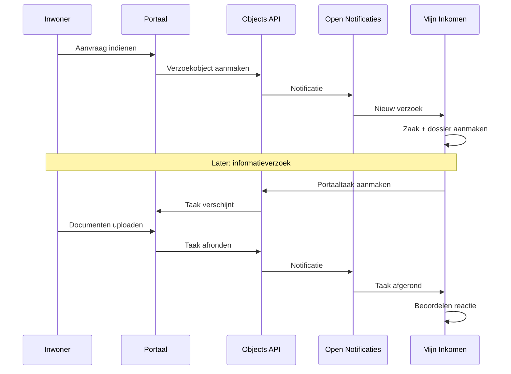

# Integraties

Mijn Inkomen koppelt met tien externe systemen. Elke koppeling loopt via een **plugin**: een herbruikbare component die per omgeving wordt geconfigureerd. De procesmodellen roepen de plugin aan; de instellingen — URL's, sleutels, wachtwoorden — zitten in configuratie en komen uit omgevingsvariabelen.

## Overzicht

| Systeem | Plugin | Waarvoor |
| --- | --- | --- |
| Open Zaak — Zaken API | `zakenapi` | Zaken, statussen, betrokkenen, resultaten |
| Open Zaak — Catalogi API | `catalogiapi` | Zaaktypen, statustypen, resultaattypen |
| Open Zaak — Documenten API | `documentenapi` | Documenten opslaan en koppelen |
| Open Zaak — Besluiten API | `besluitenapi` | Besluiten registreren |
| Objects API | `object-management` | Verzoeken, portaaltaken, beheerde lijsten |
| Open Notificaties | `notificatiesapi` | Melding van nieuwe verzoeken en afgeronde taken |
| Suwinet | `suwinet` | Brongegevens van UWV, SVB, DUO, RDW, Kadaster, BRP |
| Haal Centraal | `haalcentraalbrp`, `haalcentraalbag` | Bewoning en adresgegevens |
| Socrates | `socrates` | Dienst opvoeren in de uitkeringsadministratie |
| SMTP | `smtp-mail` | E-mailnotificaties |

Ondersteunende plugins: `value-mapper` (aanvraag omzetten naar dossierstructuur), `mail-template` en `freemarker` (brieven en e-mails), `externe-klanttaak` (taken in het portaal).

## Open Zaak — de zaakregistratie

De formele registratie van de zaak loopt via de vier ZGW-API's.



De zaak zelf: aanmaken bij binnenkomst, status bijwerken bij elke mijlpaal, betrokkenen koppelen (de aanvrager als *Initiator*), en bij afsluiting het resultaat en de einddatum vastleggen.



De metadata: welke zaaktypen er zijn, welke statustypen en resultaattypen daarbij horen. Mijn Inkomen leest hier op welke URL's het moet gebruiken bij het bijwerken van een zaak.



Alle documenten: gegenereerde brieven (ontvangstbevestiging, informatieverzoek, besluit) en door de inwoner geüploade stukken. Documenten worden als zaakinformatieobject aan de zaak gekoppeld.



Het formele besluit met de bijbehorende besluitbrief, gekoppeld aan de zaak.



Alle vier delen één authenticatieconfiguratie (`openzaak`) met client-ID en secret.


De **bronorganisatie** — het RSIN van de gemeente — is een centrale instelling die bij zaken, documenten en besluiten wordt meegegeven.


## Objects API en Open Notificaties — de koppeling met het portaal

Mijn Inkomen praat niet rechtstreeks met het klantportaal. Daar zit de Objects API tussen.



Er zijn vier objecttypen in gebruik:

| Objecttype | Functie | Zichtbaar in datamenu |
| --- | --- | --- |
| **Verzoek ALO** | De ingediende aanvraag uit het portaal. | Nee |
| **Externe Klanttaak** | Taken die bij de inwoner in het portaal verschijnen. | Nee |
| **ALO: Informatieverzoek Items** | De beheerde lijst met opvraagbare items. | Ja |
| **Adressen met veel bewoners** | Beheerde lijst voor handhavingssignalering. | Ja |

De laatste twee hebben een eigen weergave- en bewerkformulier, zodat functioneel beheerders ze zonder release kunnen onderhouden.

### Hoe een verzoek een zaak wordt

De `verzoek`-plugin luistert op notificaties en is per verzoektype geconfigureerd:

| Instelling | Waarde (Algemene bijstand) |
| --- | --- |
| Verzoektype | `Verzoek AB DCM` |
| Zaaktype | `aanvraag-algemene-bijstand-dcm` |
| Startproces | `create-zaakdossier` |
| Hoofdproces | `ab-afhandelen-aanvraag-dcm` |
| Rol van de indiener | Initiator |
| Kopieerstrategie | `specified` — alleen de benoemde onderdelen |

De mapping bepaalt welke delen van het portaalverzoek worden overgenomen: persoonsgegevens, aanvullende gegevens, gezinssamenstelling, partner- en kindgegevens. Die landen onder `verzoekGegevensTeTransformeren`, waarna de value mapping ze omzet. Zie [Datamodel](../gegevens/datamodel.md#van-portaal-naar-dossier-value-mapping).

## Socrates — de uitkeringsadministratie

Socrates is waar de uitkering uiteindelijk wordt uitgevoerd en betaald. Mijn Inkomen voert de **dienst** op: de administratieve registratie dat er een aanvraag loopt.

Dat gebeurt in de fase `opvoeren-dienst`, direct na het vaststellen van de belanghebbenden. Socrates geeft een aanvraag-ID terug dat in het dossier onder `socrates.aanvraagId` wordt bewaard — de brug tussen beide systemen.

Bijbehorende processen:

| Proces | Functie |
| --- | --- |
| `bs-opvoeren-dienst-in-socrates` | Dienst opvoeren. |
| `aanvraag-levensonderhoud.controleren-dienst-in-socrates` | Controleren of het opvoeren is gelukt. |
| `aanvraag-levensonderhoud.opnieuw-opvoeren-dienst-in-socrates` | Opnieuw proberen na een fout. |


Het opvoeren van de dienst is een **blokkerende stap**: lukt het niet, dan kan de behandeling niet door naar de vaststellingsfase. Fouten worden vastgelegd in `socratesError` en `socratesErrorCode`, zodat de behandelaar ziet wat er misging en het opnieuw kan proberen.


## Suwinet en Haal Centraal

Zie [Brongegevens](../gegevens/bronnen.md) voor wat er wordt opgehaald en waarvoor.

Technisch: Suwinet gebruikt basic authentication via een aparte authenticatieplugin, met een time-out van tien seconden voor zowel opbouwen als ontvangen. Haal Centraal werkt met API-sleutels; BRP Bewoning en de BAG hebben elk een eigen configuratie.

## E-mail

E-mailnotificaties gaan via SMTP, met configureerbare host, poort, inloggegevens en STARTTLS. De inhoud komt uit FreeMarker-sjablonen die per regeling aan een zaaktype zijn gekoppeld.

Notificaties gaan uit bij de ontvangstbevestiging, het uitzetten van een informatieverzoek en het vastleggen van het besluit — dat laatste alleen als er een e-mailadres bekend is.

Lokaal wordt **MailHog** gebruikt, zodat uitgaande mail wel verstuurd maar niet bezorgd wordt.

## Configuratie per omgeving

Plugins worden automatisch uitgerold bij het starten van de applicatie, vanuit `config/pluginconfig/`. Alle omgevingsafhankelijke waarden staan als placeholder in die bestanden en worden gevuld uit omgevingsvariabelen:

```json
{
  "id": "9221f56d-4137-4d84-aabb-c8662c54d3e7",
  "title": "Zaken API (Autodeployed)",
  "pluginDefinitionKey": "zakenapi",
  "properties": {
    "url": "${AUTODEPLOYMENT_PLUGINCONFIG_ZAKEN-API_URL}",
    "authenticationPluginConfiguration": "dddc0b4d-ae0b-4b9e-8085-d95db9e1eb4c"
  }
}
```


De **plugin-ID's zijn vaste UUID's**. Ze worden gebruikt om plugins naar elkaar te laten verwijzen — zoals hierboven, waar de Zaken API naar de authenticatieconfiguratie wijst — en om ze vanuit de procesmodellen aan te roepen. Verander ze niet: bestaande verwijzingen breken dan.


Geheimen horen niet in de repository. Lokaal staan ze in `.env.properties`; op andere omgevingen komen ze uit het secretbeheer van die omgeving. Zie [Configuratie](../beheer/configuratie.md).
