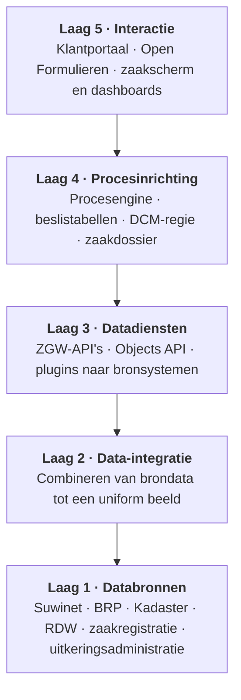
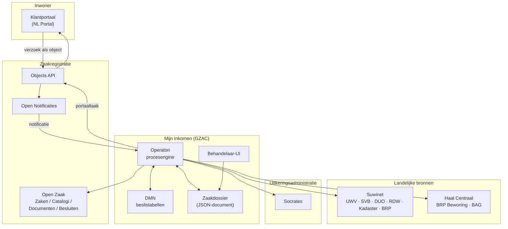
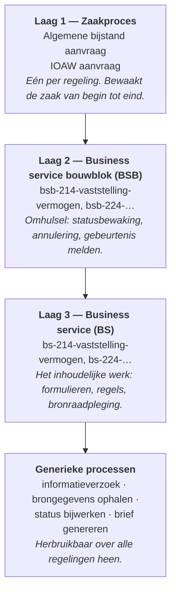
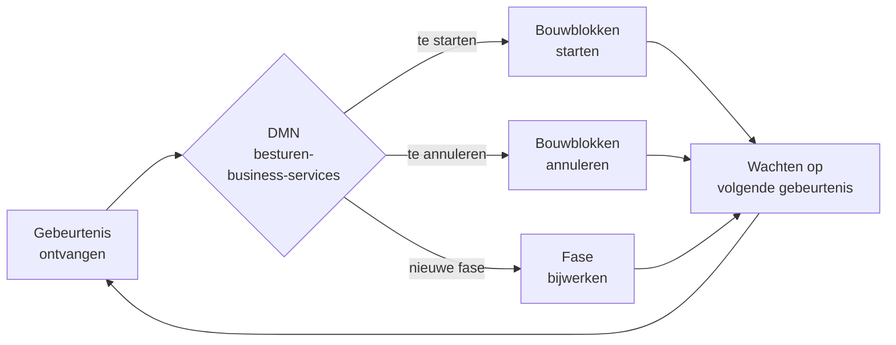

# Architectuur

## Het vijflaagsmodel

Mijn Inkomen is ingericht volgens het [Common Ground vijflaagsmodel](https://www.gemmaonline.nl/wiki/Common_Ground_vijflaagsmodel), de gemeentelijke referentiearchitectuur. Het uitgangspunt daarvan is **ontkoppeling**: data, diensten en interactie zitten in aparte lagen, zodat je het ene kunt vervangen zonder het andere te raken.

De lagen tellen van onder naar boven: databronnen onderaan als laag 1, interactie bovenaan als laag 5.

Waar de onderdelen van Mijn Inkomen zitten:

| Laag | Wat daar thuishoort |
| --- | --- |
| **5 · Interactie** | Het klantportaal waarop de inwoner indient, de formulierenengine, en het zaakscherm met tabbladen, taakformulieren en dashboards voor de behandelaar. |
| **4 · Procesinrichting** | De procesengine met de BPMN-modellen, de DMN-beslistabellen, de dynamische regie die bepaalt welk werk wanneer loopt, en het zaakdossier waarin de behandeling wordt vastgelegd. |
| **3 · Datadiensten** | De API's waarmee brondata wordt geleverd en weggeschreven: de ZGW-API's, de Objects API, en de plugins waarmee de bronsystemen worden bevraagd. |
| **2 · Data-integratie** | Het combineren van data uit verschillende bronnen tot één passend beeld. Mijn Inkomen heeft hier geen eigen component: het samenbrengen van aanvraag- en brongegevens gebeurt in het zaakdossier, in laag 4. |
| **1 · Databronnen** | De registraties zelf: Suwinet met UWV, SVB, DUO, RDW en Kadaster, de BRP, de zaakregistratie en de uitkeringsadministratie. |


**GZAC beslaat meer dan één laag.** De applicatie levert zowel het zaakscherm (laag 5) als de procesregie (laag 4). Dat is geen afwijking van het model: een component mag meerdere lagen bedienen, zolang de lagen intern gescheiden blijven.



**De ontkoppeling is hier geen theorie.** Dat de schermen (laag 5) losstaan van de procesinrichting (laag 4), en die weer van de bronsystemen (laag 1), is precies waarom een formulier aangepast kan worden zonder het procesmodel te raken — en waarom de behandeling doorloopt als een bron onbereikbaar is.


## Het landschap

Mijn Inkomen staat niet op zichzelf. De applicatie is de behandelkant van een keten die begint bij de inwoner en eindigt in de uitkeringsadministratie.

### Rollen in de keten

| Onderdeel | Rol |
| --- | --- |
| **Klantportaal** | De inwoner dient hier de aanvraag in en reageert op informatieverzoeken. |
| **Objects API** | Postbus tussen portaal en behandeling: het verzoek en de portaaltaken staan hier als object. |
| **Open Notificaties** | Meldt aan Mijn Inkomen dat er een nieuw verzoek of een afgeronde taak is. |
| **Mijn Inkomen** | Voert de behandeling uit: procesregie, gegevensverzameling, beoordeling, besluit. |
| **Open Zaak** | De formele zaakregistratie: zaak, status, documenten, besluiten. |
| **Suwinet / Haal Centraal** | Leveren brongegevens over persoon, inkomen, vermogen en bewoning. |
| **Uitkeringsadministratie** | Waar de dienst wordt opgevoerd en de uitkering wordt betaald. Deze koppeling is optioneel; zie [Integraties](../koppelingen/integraties.md#uitkeringsadministratie). |

## Twee soorten waarheid

Een belangrijk onderscheid in de architectuur: **het zaakdossier** en **de zaakregistratie** zijn twee verschillende dingen.



Een JSON-document dat volledig door Mijn Inkomen wordt beheerd. Hierin staat álles wat tijdens de behandeling wordt verzameld en vastgesteld: aanvraaggegevens, opgehaalde brongegevens, vaststellingen van de behandelaar, informatieverzoeken en besluiten.

Het schema ligt vast in `aanvraag-algemene-bijstand-dcm.schema.json` respectievelijk `aanvraag-ioaw-uitkering-dcm.schema.json`. Zie [Datamodel](../gegevens/datamodel.md).

Dit is het **werkdossier**.



De formele registratie volgens de ZGW-standaarden: zaaknummer, zaaktype, status, resultaat, betrokkenen, documenten en besluiten.

Mijn Inkomen schrijft hier de mijlpalen naartoe — niet elke tussentijdse wijziging. De zaak in Open Zaak is wat andere systemen en toezichthouders zien.

Dit is de **officiële registratie**.



Het zaakdossier bevat onder `openzaak` een verwijzing naar de bijbehorende zaak, zodat beide werelden aan elkaar geknoopt blijven.

## De procesarchitectuur: drie lagen


Deze drie lagen staan los van het vijflaagsmodel hierboven. Ze beschrijven hoe de procesmodellen binnen laag 4 onderling zijn opgebouwd.


De BPMN-modellen zijn bewust in drie lagen verdeeld. Dat maakt hergebruik tussen Algemene bijstand en IOAW mogelijk, en houdt de losse modellen klein.

### Waarom een bouwblok én een business service?

De **business service** (BS) doet het inhoudelijke werk: een formulier aanbieden, een bron raadplegen, een regel toepassen. Die wil je zuiver houden.

Het **bouwblok** (BSB) eromheen regelt de dingen die voor élke business service hetzelfde zijn:

* de status bijhouden (`gestart` → `afgerond` / `geannuleerd`);
* netjes afbreken als de regie besluit dat deze service niet meer nodig is;
* de afrondende gebeurtenis terugmelden aan de regie.

Door die scheiding kan de centrale regie ieder bouwblok op dezelfde manier starten en annuleren, zonder iets te weten van wat erin gebeurt.

## De regie: een beslistabel als dirigent

In het zaakproces draait een subproces `uitvoeren-business-services`. Dat is een lus die steeds hetzelfde doet:

De beslistabel krijgt zeven invoerwaarden:

1. **Zaakdossiertype** — Algemene bijstand of IOAW;
2. **Huidige fase** — waar in de behandeling de zaak zit;
3. **Ontvangen gebeurtenis** — wat er zojuist gebeurd is;
4. **Aanvraag bevat partner** — bepaalt of partnerspecifieke bouwblokken nodig zijn;
5–7. **Is fase X afgerond?** — drie afgeleide beslissingen die bewaken of alle vaststellingen klaar zijn.

Daaruit volgen drie uitkomsten: welke bouwblokken moeten starten, welke moeten stoppen, en wat de nieuwe fase is.


Dit is de kern van het hele ontwerp. Wie wil begrijpen waarom een zaak doet wat hij doet, kijkt naar de beslistabel `besturen-business-services`. Zie [Het aanvraagproces](../functionaliteit/aanvraagproces.md) voor de fasen en gebeurtenissen.


## Configuratie boven code

De applicatie bevat precies één Kotlin-bestand: `Application.kt`, de Spring Boot-startklasse. Alle functionaliteit zit in configuratie die bij het starten automatisch wordt uitgerold.

| Soort | Map | Inhoud |
| --- | --- | --- |
| Bouwblokken | `config/building-block` | Zestig blokken, elk met eigen procesmodel, formulieren, links en schema |
| Zaakconfiguratie | `config/case` | Geversioneerde zaakdefinities, statussen, labels, tabbladen, zaaklijsten |
| Gedeelde schema's | `config/document` | Referentieschema's die blokken delen |
| Gedeelde onderdelen | `config/global` | Formulieren en links die over blokken heen gaan |
| Dashboards | `config/dashboard` | Stuurinformatie |
| Koppelingen | `config/pluginconfig` | Plugininstellingen per omgeving |
| Rechten | `config/pbac` | Rollen en permissies, één bestand per rol |

Zie [Configuratie](../beheer/configuratie.md) voor de details.
